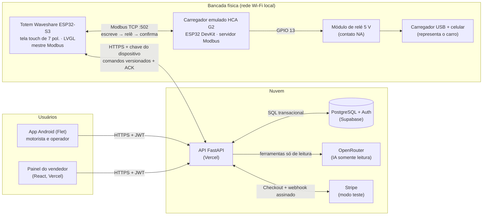
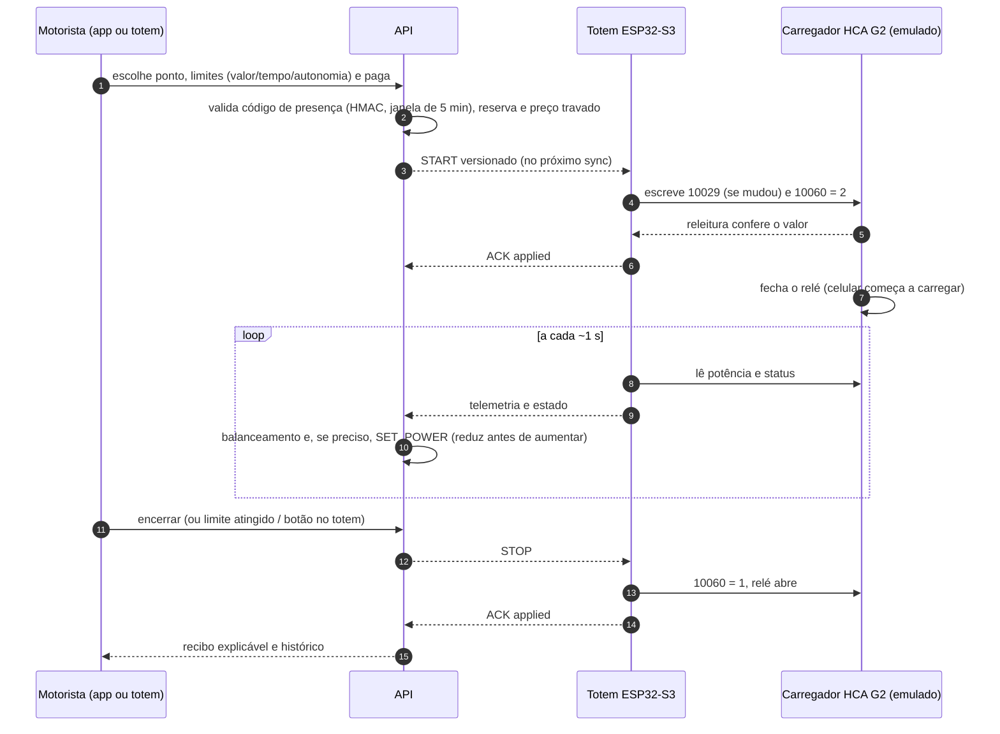
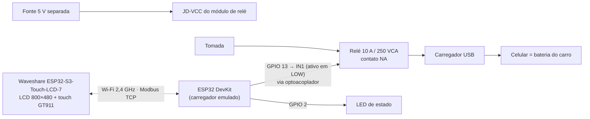
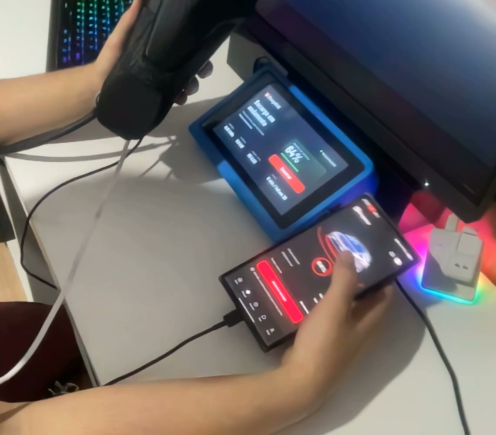
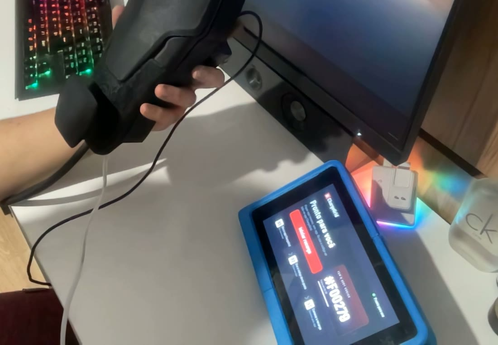
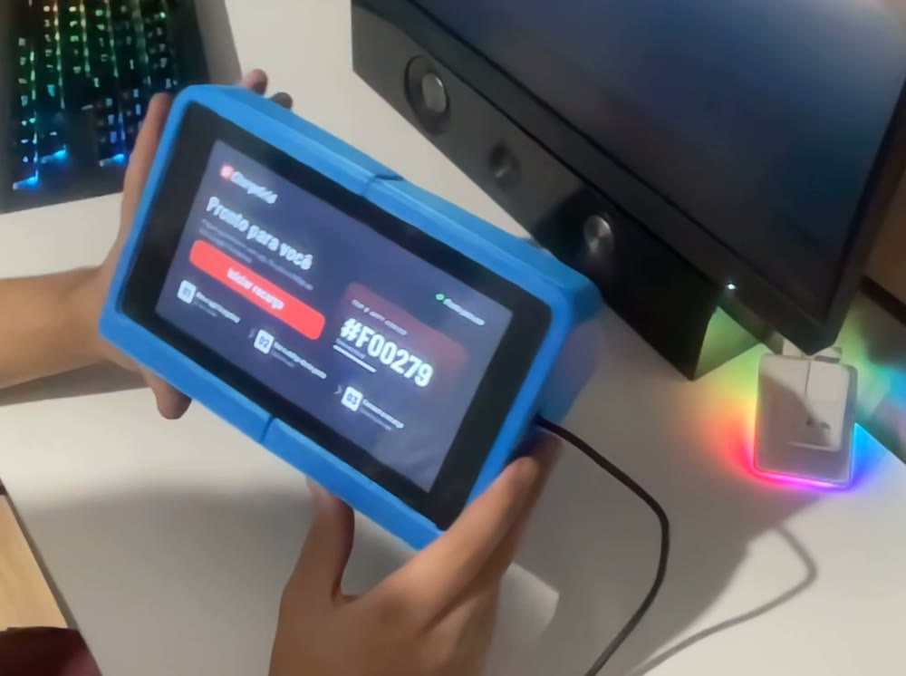
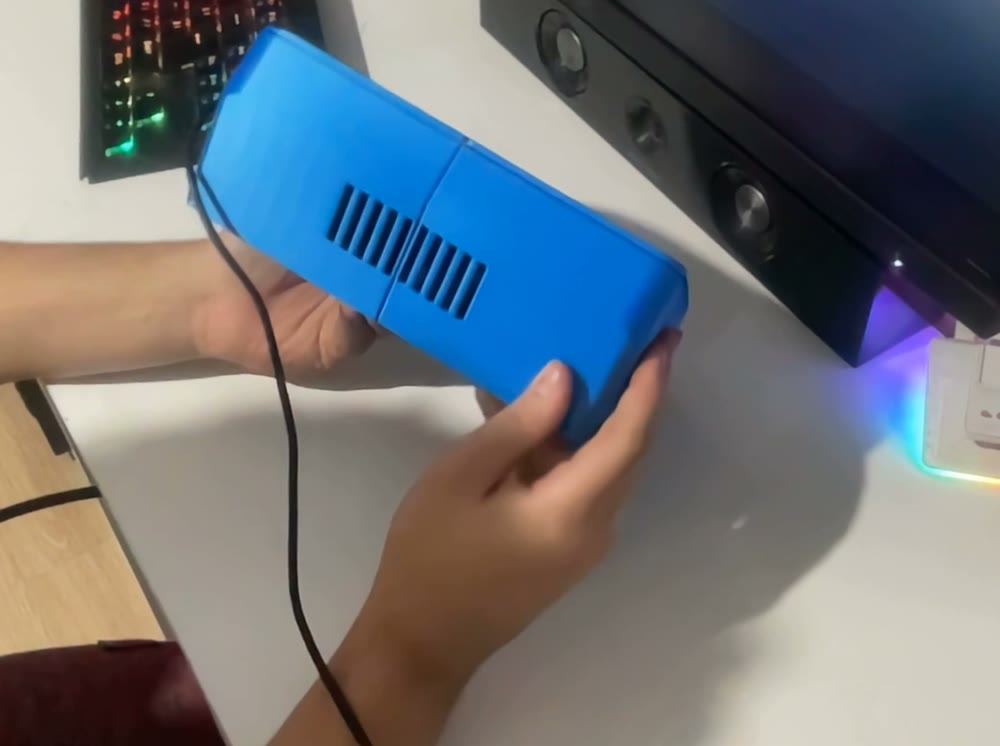
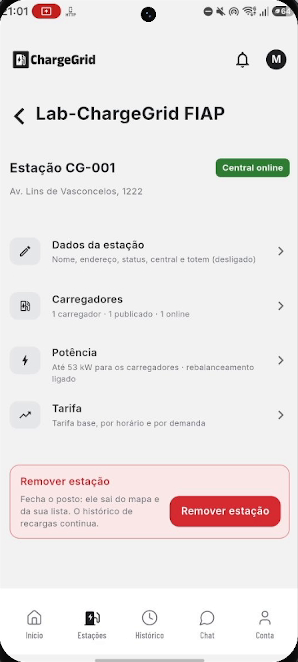
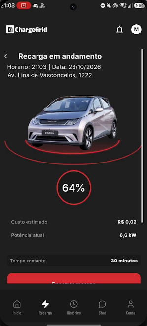
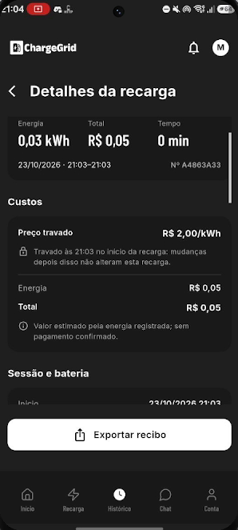

<div align="center">


# ChargeGrid

**Gestão de eletropostos integrada ao carregador GoodWe HCA G2: do app ao relé, com confirmação do equipamento.**

Projeto da equipe **FFIVE** (FIAP · EV Challenge GoodWe × FIAP 2026)

`Python` · `FastAPI` · `Flet` · `React` · `PostgreSQL` · `ESP32-S3` · `LVGL` · `Modbus TCP` · `Stripe (teste)` · `OpenRouter`

**[▶ Vídeo técnico (até 5 min)](https://youtu.be/vN4E6dH7obQ)** · **[Site e painel online](https://chargegrid-ffive.vercel.app)** · [Arquitetura](#3-arquitetura-final) · [Desafio GoodWe](#5-alinhamento-ao-desafio-goodwe-e-à-disciplina) · [Resultados](#6-resultados-obtidos) · [Sustentabilidade](#7-avaliação-crítica-sustentabilidade-automação-eficiência-e-inovação) · [Tecnologias](#8-tecnologias-sensores-e-referências)

</div>

> **O que é real e o que é simulado.** São reais: o app, o painel web, a API publicada, o totem físico (ESP32-S3 com tela de 7"), o carregador emulado (ESP32 com relé) e a comunicação **Modbus TCP** entre as duas placas. O relé liga de verdade a tomada de um carregador de celular, e **a bateria do celular representa a do carro**. São simulados: a potência e a energia registradas (o valor configurado no carregador enquanto o relé está fechado), o consumo da loja (estimativa informada pelo dono), os pagamentos (Stripe em modo teste ou pagamento simulado), o saldo e o resgate. **Nada foi validado ainda em um HCA G2 comercial.**

---

## 1. Projeto e equipe

| | |
| --- | --- |
| **Título** | ChargeGrid: plataforma de gestão de eletropostos com controle de demanda e integração ao GoodWe HCA G2 |
| **Equipe** | FFIVE |
| **Vídeo técnico** | https://youtu.be/vN4E6dH7obQ |
| **Site / painel do vendedor** | https://chargegrid-ffive.vercel.app |
| **Repositório** | https://github.com/DJLIMA1/FIAP-ChargeGridApp-GS1-2026 |

| Integrante | RM |
| --- | ---: |
| Augusto de Souza Ávila | 570839 |
| Davi Simoncelo | 571738 |
| João Pedro Sousa | 573962 |
| Matheus Evangelista Silva | 568593 |
| Murilo Lima de Carvalho | 570156 |

## 2. Problema e proposta

Com a expansão dos veículos elétricos, quem tem um ponto de recarga (posto, loja, estacionamento) precisa **cobrar, controlar a potência para não estourar o limite contratado com a distribuidora e operar sem funcionário**. O motorista, por sua vez, precisa achar um ponto disponível, saber quanto vai pagar e ter certeza de que a recarga começou.

O carregador GoodWe HCA G2 já traz controle de potência e agendamento. O ChargeGrid acrescenta a **camada comercial e operacional** sobre ele:

- **Motorista:** busca, compara, reserva e paga no app ou direto no totem.
- **Dono:** publica pontos e tarifas, acompanha receita e ocupação e recebe sugestões.
- **Sistema:** divide a potência disponível entre os carros e só considera um comando executado depois que o equipamento confirma.

## 3. Arquitetura final

### 3.1 Componentes



| Camada | Função | Código |
| --- | --- | --- |
| App (Flet, Python 3.12, APK Android) | Motorista (tema claro): busca, reserva, recarga, histórico e chat com IA. Operador (tema escuro): cadastro do ponto por QR, tarifas, potência e totem | [`apps/mobile/`](apps/mobile/) |
| Painel do vendedor (React + Vite) | KPIs, receita, ocupação, mapa de calor, status ao vivo, sessões, exportação, cupons e Insights IA | [`apps/owner-web/`](apps/owner-web/) |
| API (FastAPI, Python 3.11, Vercel) | Autenticação, permissões, reservas, sessões, pagamentos, comandos aos dispositivos, balanceamento, previsão e IA | [`apps/api/`](apps/api/) |
| Núcleo compartilhado (Python puro) | Regras usadas por API, app e testes: balanceamento, tarifas, recibo, economia do dono, adaptador HCA G2, previsão e laço da IA | [`packages/chargegrid_core/`](packages/chargegrid_core/) |
| Totem / central (ESP32-S3, C++) | Tela touch de autoatendimento, sincronização HTTPS com a API e **cliente (mestre) Modbus TCP** do carregador | [`firmware/esp32/`](firmware/esp32/) |
| Carregador emulado (ESP32, C++) | Implementa o mapa Modbus do HCA G2 e aciona o relé | [`firmware/goodwe-hca-sim/`](firmware/goodwe-hca-sim/) · mapa em [`firmware/shared/hca_g2/`](firmware/shared/hca_g2/) |
| Banco (PostgreSQL / Supabase) | Contas, postos, pontos, reservas, sessões, dispositivos, comandos, telemetria e pagamentos (31 migrações Alembic) | [`apps/api/migrations/`](apps/api/migrations/) |
| Ferramentas | Simulador de dispositivo, provisionamento, demo de rebalanceamento, validação de firmware e build do APK | [`tools/`](tools/) |

### 3.2 Integração dos sistemas

**Nuvem ↔ totem.** O totem chama `POST /v1/devices/sync` com uma chave individual por dispositivo (só o hash fica no banco) e TLS validado. Ele sincroniza **a cada 1 s** enquanto há sessão ou comando pendente e **a cada 5 s** quando está ocioso. Recebe comandos versionados (`RESERVE`, `START`, `STOP`, `SET_POWER`, `RELEASE`) e responde `ACK applied` ou `ACK failed`. A API roda na Vercel e não alcança a rede local, por isso decide a potência em watts, e o totem traduz essa decisão para Modbus.

**Totem ↔ carregador (Modbus TCP, porta 502).** O totem é o mestre e o carregador emulado é o servidor. O carregador é encontrado por mDNS (`cg-hca-<n>.local`) ou IP fixo. O mapa segue o protocolo Modbus do *AC EV Charger Gen2* (V1.0.15):

| Registrador | Significado | Uso no ChargeGrid |
| --- | --- | --- |
| 10029 | Potência máxima de carga (0,1 kW; 1,4–7,0 kW no GW7K-HCA-20) | Escrito **só quando muda** (a escrita grava na flash do carregador) |
| 10060 | Liga/desliga (2 liga, 1 desliga) | `START`, `STOP` e pausa abaixo do mínimo de 6 A |
| 10032 | Modo de carga | Escrito uma vez por conexão |
| 10015 / 10017 | Potência atual / status (livre, plugado, carregando, concluído, alarme, falha) | Leitura a cada ~1 s |
| 10024–10026 | Gestão dinâmica e disjuntor da instalação | **Nunca escritos** (garantido por teste) |

Toda escrita é **relida** antes do ACK. Se o valor relido diverge, o ACK vem como `failed readback_mismatch`. Ou seja, um pedido só vira ação aplicada quando o equipamento confirma.

**Segurança da bancada:**
- O relé usa contato normalmente aberto e fica desligado no boot, no reset e em falha.
- O carregador abre o relé se ficar 15 s sem contato do mestre.
- O totem faz parada segura se perder o carregador por 5 s durante a recarga, ou a API por 45 s.
- Depois de reiniciar, nenhuma sessão recomeça sem nova autorização.

### 3.3 Fluxo de uma recarga



No **totem de autoatendimento**, a mesma jornada ocorre sem app:
1. Escolher o carregador e o valor ou tempo.
2. Escolher a velocidade: máxima, ou reduzida com desconto.
3. Pagar via Pix/cartão (Stripe teste) ou com o pagamento simulado do modo apresentação.
4. Revisar e iniciar. O totem nunca liga sozinho: o `START` vem do servidor.
5. Acompanhar a recarga e encerrar com confirmação.
6. Receber o recibo com QR.

### 3.4 Circuito funcional da bancada



Detalhes de ligação e decisões: [carregador HCA simulado](docs/carregador-hca-simulado.md) · [adaptador HCA G2](docs/adaptador-hca-g2.md) · [protocolo ESP32](docs/esp32-protocol.md).

## 4. O sistema funcionando (imagens reais)

Fotos e telas tiradas da gravação da bancada em 23/10/2026:

<table>
  <tr>
    <th>Recarga em andamento: totem, celular e app</th>
    <th>Carregador impresso em 3D (molde do HCA, 50%)</th>
  </tr>
  <tr>
    <td align="center"></td>
    <td align="center"></td>
  </tr>
  <tr>
    <th>Totem Waveshare 7" no case 3D</th>
    <th>Case com ventilação e passagem de ar</th>
  </tr>
  <tr>
    <td align="center"></td>
    <td align="center"></td>
  </tr>
</table>

<table>
  <tr>
    <th>Operador: estação publicada</th>
    <th>Motorista: recarga em andamento</th>
    <th>Histórico com detalhes</th>
  </tr>
  <tr>
    <td align="center"></td>
    <td align="center"></td>
    <td align="center"></td>
  </tr>
</table>

Também há o [painel do vendedor](docs/images/dashboard-visao-geral.png), os [Insights IA](docs/images/dashboard-insights-ia.png), o [chat com IA](docs/images/app-chat-ia.png) e o [framebuffer lido do painel físico](docs/images/painel-esp32-framebuffer.png). As capturas do painel e da IA vêm da conta demo, com dados fictícios. Os renders do case estão em [`docs/case-tela-waveshare-7/`](docs/case-tela-waveshare-7/).

## 5. Alinhamento ao desafio GoodWe e à disciplina

### 5.1 Como cada parte responde ao desafio

| Ponto-chave do desafio | Como o ChargeGrid resolve | Onde está |
| --- | --- | --- |
| **Integrar o equipamento GoodWe** | Adaptador e emulador compatíveis com o mapa Modbus TCP do HCA G2. O HCA G2 foi escolhido por ser o carregador do desafio e por expor Modbus TCP documentado (não tem OCPP nem API SEMS+ para terceiros). | `chargers/goodwe_hca_g2.py`, `firmware/goodwe-hca-sim`, `firmware/esp32/src/charger_link.cpp` |
| **Gestão de demanda elétrica** | O balanceamento divide entre os carros sessão a sessão `min(teto dos carregadores, limite contratado − pico estimado da loja)`. O piso é de 1,4 kW por carro (6 A). Reduções vão primeiro, aumentos só com folga confirmada, e cada decisão fica registrada com o motivo. | `balancing.py`, `power.py`, `site_load.py` |
| **Confirmação, não suposição** | Comando escrito, relido e confirmado (ACK). A recuperação trata respostas perdidas, pedidos repetidos (idempotência) e reservas concorrentes. | API `devices` e `charging`, firmware |
| **Cobrança e viabilidade comercial** | Tarifa por kWh, por faixa horária e por demanda, preço travado no início, velocidade reduzida com desconto, taxa de permanência, cupons, Stripe em teste, comissão configurável para a GoodWe e aluguel do totem | `pricing.py`, `overstay.py`, `economics.py`, `rent.py`, `payments/` |
| **Operação sem funcionário** | Totem de autoatendimento com a jornada completa: escolha, revisão, pagamento, início, encerramento e recibo | `firmware/esp32` (0.9.x) · [totem 0.9.3](docs/autoatendimento-totem-0.9.3.md) |
| **Gestão do dono** | Painel web com receita, energia, ocupação, picos e alertas, previsão de ocupação e Insights IA com sugestões de preço que exigem revisão do dono | `apps/owner-web`, `forecast/` |
| **Demonstração com hardware** | Bancada com totem, carregador emulado, relé e celular, que declara o que é real e o que é simulado | seção 4 |

### 5.2 Ligação com a disciplina

| Conteúdo | Aplicação |
| --- | --- |
| Sistemas embarcados e IoT | Duas placas ESP32: tela touch com LVGL, máquina de estados, watchdog, NVS e acionamento de relé |
| Redes e protocolos | HTTPS/JSON com comandos versionados e ACK, Modbus TCP (FC03/FC06/FC16) implementado sem biblioteca externa, mDNS e Wi-Fi |
| Banco de dados | Modelo relacional, migrações e transações para reservas concorrentes |
| Segurança | JWT, chave individual por dispositivo, QR privado de propriedade separado do código público, código de presença HMAC, TLS e RLS |
| Engenharia de software | Monorepo em camadas, núcleo compartilhado, cerca de 1.700 testes automatizados e CI no GitHub Actions |
| IA aplicada | Assistente com ferramentas só de leitura, benchmark de modelos e previsão com validação contra um baseline |

## 6. Resultados obtidos

### 6.1 Quantitativos

**Qualidade de software.** As contagens abaixo foram executadas em 21/10/2026:

| Parte | Testes |
| --- | ---: |
| API, contra PostgreSQL 16 | 425 |
| App | 762 + 129 subtestes |
| Núcleo | 246 |
| Painel React | 120 |
| Ferramentas | 47 |
| Modbus TCP (loopback contra o emulador) | 5 |

- Total: **1.607 testes aprovados**, além de testes de host do firmware em C++ com sanitizers.
- Ressalva: 2 testes do app falharam nessa rodada porque traziam expectativas anteriores ao balanceamento.
- Na validação do totem 0.9.3: API com 467 testes, núcleo com 251, app com 798.
- O CI no GitHub Actions roda a API, o app, o núcleo, o scanner Flutter, as ferramentas e o build do firmware a cada push.

**Ensaios na placa física (21/09/2026).** Foram 14 verificações ponta a ponta aprovadas: login, propriedade do equipamento, idempotência da reserva com ACK real, telemetria, isolamento entre contas e histórico ([resultados](docs/qa-live-results.json)). As medições são simuladas:

| Ensaio | Energia | Custo | Resultado |
| --- | ---: | ---: | --- |
| Parada pelo app | 60,392 Wh | R$ 0,0906 | `completed` |
| Parada local no totem | 12,084 Wh | R$ 0,0181 | `completed` |
| Teto de R$ 0,01 | 6,666 Wh | R$ 0,0100 | `cost_limit` (parou sozinho no limite) |

**Totem 0.9.x na placa:**
- Imagem gravada com hash verificado.
- Boot confirmou Wi-Fi, identidade e sincronização (`http=200`).
- Usa 144 KB de 320 KB de RAM estática e 2,0 MB de 6,5 MB de flash.
- A tela mais pesada ocupa no máximo 53% do pool do LVGL.

**Desempenho, segundo a [auditoria de QA](docs/qa-auditoria-2026-10.md):**

| Item | Antes | Depois |
| --- | ---: | ---: |
| Consultas ao banco na listagem de postos | 183 | 8 |
| Consultas ao banco no histórico | 123 | 6 |
| Primeira pintura da home | 7,0 s | 0,36 s |
| Redesenho do mapa | 7 s | 4 ms |

Também foram corrigidos 18 defeitos, todos com teste de regressão.

**IA ([benchmark](docs/ia-openrouter.md)).** Foram testados 11 modelos com 11 casos cada, e depois 4 finalistas com 3 repetições. O modelo escolhido, `deepseek/deepseek-v4.1-flash`, teve:
- 100% de acerto (33/33);
- latência p50 de 2,0 s e p95 de 5,5 s;
- custo de **US$ 0,00037 por conversa**.

O uso tem limites por usuário (20 pedidos a cada 10 min e 200 por dia).

**Previsão de ocupação ([detalhes](docs/previsao-ocupacao.md)).** Um modelo de gradient boosting foi comparado com a média suavizada:
- erro médio por hora de 16,08 → 14,98 p.p. (−6,8%);
- WAPE de 70,7% → 65,9%;
- o ganho se manteve em postos nunca vistos.

A avaliação usou **histórico sintético**. O modelo só substitui a média quando vence o baseline no próprio posto.

**Rebalanceamento ([demo](docs/adaptador-hca-g2.md)).** Em um posto com 30 kW contratados, quando o 2º carro entra, o primeiro é reduzido para 6,0 kW. Só depois do ACK o novo sobe. Se a loja passa a ocupar mais, todos descem juntos e o limite contratado nunca é ultrapassado.

### 6.2 Qualitativos

- A recarga é confirmada pelo equipamento em cada etapa: o app mostra "pendente", "confirmado" ou "falhou", sem fingir sucesso.
- A jornada completa funciona **sem app**, pelo totem, e o recibo explica preço travado, energia e decisões de potência.
- A conexão é tolerante a falhas: reconexão, resposta perdida e reinício da placa não deixam o relé ligado nem cobram em dobro.
- O operador cadastra um ponto em cerca de 1 minuto, lendo o QR da central (como no vídeo).

## 7. Avaliação crítica: sustentabilidade, automação, eficiência e inovação

| Ganho | Mecanismo no sistema | Status |
| --- | --- | --- |
| **Usar a rede existente em vez de ampliá-la** | O balanceamento mantém a soma dos carros abaixo de `limite contratado − pico da loja`. O padrão segue a REN ANEEL 1.000/2021: até 75 kW no Grupo B. Assim o posto atende mais carros sem trocar transformador, migrar para média tensão ou pagar ultrapassagem de demanda. | Implementado e testado (regra e simulação); não medido em campo |
| **Deslocar consumo para fora do pico** | Tarifa por faixa horária, multiplicador por demanda, sugestão de "melhor horário" ao motorista e de tarifa de horário vazio ao dono. Isso achata a curva de carga da rede. | Implementado; impacto em kWh não medido |
| **Mais carros por carregador** | Taxa de permanência libera a vaga quando a recarga termina. Reserva com código de presença evita vaga bloqueada. Previsão ajuda o dono a dimensionar. | Implementado |
| **Vida útil do equipamento** | A potência só é escrita no HCA quando muda (registrador 10029 grava na flash), e o modo de carga é escrito uma vez | Implementado e testado |
| **Automação** | Início, parada e ajuste de potência automáticos com ACK. Parada por limite de valor ou tempo. Pagamento com devolução da sobra. Totem sem atendente. Insights para o dono | Implementado |
| **Eficiência operacional** | Consultas ao banco 20× menores, IA a ~R$ 0,002 por conversa e infraestrutura serverless sem servidor ocioso | Medido (seção 6) |
| **Segurança elétrica** | Relé NA desliga sem comando, watchdog de 15 s, parada segura, sem religar após reboot e pausa abaixo de 6 A | Implementado na bancada; não é certificação |

**Crítica honesta:**
- **Não há medição real de energia nem de CO₂.** Os ganhos ambientais são potenciais, decorrentes de usar melhor a infraestrutura existente e deslocar a demanda. Não são números de campo.
- **Falta testar num HCA G2 comercial.** O mapa Modbus vem do documento do fabricante, conhecido por transcrições públicas, e foi conferido com o datasheet oficial.
- **O relé é liga/desliga.** A redução de potência só aparece nos registradores do emulador, não na corrente do celular.
- **O consumo da loja é estimado**, não medido. Com um medidor, o balanceamento pode liberar mais potência nos horários vazios.
- **A previsão só foi validada em dados sintéticos.** Pagamentos estão em modo teste. O hosting está em planos gratuitos.
- **Próximos passos:** validar num HCA G2 real, integrar um medidor (loja e solar) e adicionar indicadores de kWh deslocado e CO₂ evitado.

**Inovação:**
- Pedido e ação aplicada são estados diferentes, ligados por **releitura no equipamento**.
- Dois firmwares conversam por Modbus TCP, reproduzindo a arquitetura real totem + carregador.
- O QR de propriedade é separado da chave do dispositivo e do código público.
- O totem usa o mesmo renderer das telas do app.
- A IA não executa ações.
- A previsão só entra quando supera um baseline.

## 8. Tecnologias, sensores e referências

| Área | Tecnologias |
| --- | --- |
| Linguagens | Python 3.11/3.12, C++17, TypeScript, SQL, Dart (plugins Flutter) |
| App | Flet 1.0.0, flet-geolocator, httpx, Pillow, MapLibre/OpenFreeMap, scanner de QR em Flutter 3.44.8 |
| API | FastAPI, Uvicorn, SQLAlchemy 2, psycopg 3, Alembic, PyJWT, pydantic-settings, ReportLab (recibo PDF) |
| Painel web | React 18.3, React Router 6, Recharts 3, Vite 6, Vitest, ESLint |
| Firmware do totem | PlatformIO, Arduino-ESP32 3.1.1 (pioarduino), LVGL 8.4.0, ESP32_Display_Panel 1.0.4, ESP32_IO_Expander 1.1.0, ArduinoJson 7.2.1, mDNS, NVS e TLS |
| Firmware do carregador | PlatformIO, Arduino-ESP32 2.0.17 (espressif32 6.9.0), Modbus TCP próprio (FC03/06/16) |
| Nuvem e serviços | Vercel (API e site), Supabase (PostgreSQL e Auth), Stripe (modo teste), OpenRouter, GitHub Actions |
| IA / ML | `deepseek/deepseek-v4.1-flash` via OpenRouter, com 2 modelos de reserva; scikit-learn (treino offline, modelo exportado em Python puro) |
| Ferramentas de teste | pytest, ruff, Vitest, testes de host em C++ com sanitizers, mbpoll e pymodbus |
| Fabricação | Impressão 3D em PLA (Ender 3): case da tela e carregador em escala 50% no molde do HCA ([case](docs/case-tela-waveshare-7/), [protótipo](docs/prototipo-usb/)) |

**Hardware, sensores e atuadores:**

| Item | Tipo | Real ou simulado |
| --- | --- | --- |
| Waveshare ESP32-S3-Touch-LCD-7: LCD RGB 800×480, touch capacitivo GT911, Wi-Fi, 16 MB de flash, PSRAM | Interface e comunicação | Real |
| ESP32 DevKit (ESP32-WROOM-32) | Controlador do carregador emulado | Real |
| Módulo de relé 5 V com optoacoplador, contato NA de 10 A / 250 VCA, IN1 na GPIO 13 | Atuador | Real |
| LED de estado (GPIO 2) | Atuador | Real |
| Carregador USB + celular (a bateria representa o carro) | Carga | Real |
| Câmera e GPS do celular (QR de propriedade e busca por proximidade) | Sensores | Real |
| Potência, energia, SoC e consumo da loja | Medição | **Simulado**: não há sensor de corrente, tensão nem medidor |

**Referências:**
- [GoodWe HCA G2: página oficial](https://br.goodwe.com/carregadores-hca-g2-goodwe) e datasheet (modelos, fases e Modbus TCP).
- *AC EV Charger Gen2 Modbus Protocol* V1.0.15, via transcrições públicas da comunidade (Home Assistant `sems_wallbox`, evcc). Detalhes em [adaptador HCA G2](docs/adaptador-hca-g2.md).
- ANEEL, Resolução Normativa nº 1.000/2021, art. 23: limite de 75 kW para o Grupo B.
- Documentação de [LVGL](https://lvgl.io), [FastAPI](https://fastapi.tiangolo.com), [Flet](https://flet.dev), [Supabase](https://supabase.com/docs), [Stripe (modo teste)](https://docs.stripe.com/testing) e [OpenRouter](https://openrouter.ai/docs).

## 9. Organização do repositório

```text
apps/
  api/          API FastAPI, migrações, testes
  mobile/       app Flet (motorista e operador) e plugins Flutter
  owner-web/    site e painel do vendedor (React)
  dashboard/    painel Flet anterior
packages/chargegrid_core/   regras compartilhadas (balanceamento, tarifas, HCA G2, previsão, IA)
firmware/
  esp32/            totem Waveshare (LVGL, sync HTTPS, mestre Modbus)
  goodwe-hca-sim/   carregador HCA G2 emulado (servidor Modbus + relé)
  shared/hca_g2/    mapa de registradores e Modbus TCP
tools/      simulador, provisionamento, demo de rebalanceamento, build, validação
docs/       arquitetura, protocolo, validações, roteiros, imagens, case 3D
```

A branch [`Simulado`](https://github.com/DJLIMA1/FIAP-ChargeGridApp-GS1-2026/tree/Simulado) guarda a versão anterior, executável localmente com dados em JSON.

## 10. Como executar

Requisitos:
- **Python 3.12** para o app;
- **Python 3.11** para a API;
- **Node 20+** para o painel web;
- **PlatformIO** para o firmware.

Copie [`.env.example`](.env.example) para `.env` e preencha os valores. O `.env` é ignorado pelo Git.

```bash
# App, na raiz
python3.12 -m venv .venv && source .venv/bin/activate
pip install -r requirements.txt
python src/main.py
```

```bash
# API
cd apps/api
python3.11 -m venv .venv && source .venv/bin/activate
pip install -r requirements.txt
alembic upgrade head
uvicorn app.main:app --reload
```

```bash
# Firmware: totem e carregador emulado
pio run -d firmware/esp32 -e waveshare_panel_ui
pio run -d firmware/goodwe-hca-sim
python tools/validate_firmware.py
```

```bash
# Painel do vendedor com dados fictícios (http://localhost:5199/dashboard/?mock_login=1)
cd apps/owner-web && npm ci && npm run dev:mock
```

**Prévia do app sem API e sem placa:**

```bash
PYTHONPATH=apps/mobile/src .venv/bin/python tools/preview_mobile_flows.py
```

Depois abra http://127.0.0.1:8855 e toque em "Entrar na conta demo". A conta demo só existe com `CHARGEGRID_ENABLE_DEMO=1` e fica desligada no APK.

Também estão documentados:
- a [demo de rebalanceamento](docs/adaptador-hca-g2.md) com `tools/demo_rebalance.py`;
- o [simulador de dispositivo](docs/demo.md#demonstração-integrada-com-api-e-dispositivo);
- o [guia completo](docs/setup.md), que cobre banco, Auth, provisionamento por QR, APK e implantação.

| Variável | Onde | Uso |
| --- | --- | --- |
| `CHARGEGRID_API_URL` | app e dashboard | URL da API (HTTPS; HTTP só em localhost) |
| `CHARGEGRID_ENABLE_DEMO` | app e dashboard | `1` liga a conta demo (só desenvolvimento) |
| `DATABASE_URL`, `MIGRATION_DATABASE_URL` | API | PostgreSQL de execução e de migração |
| `SUPABASE_URL`, `SUPABASE_ANON_KEY` | API | autenticação |
| `CORS_ORIGINS` | API | origens web permitidas |
| `OPENROUTER_API_KEY`, `OPENROUTER_MODEL`, `OPENROUTER_FALLBACK_MODELS` | API | IA (vazio = regras locais) |

## 11. Documentação

| Tema | Link |
| --- | --- |
| Carregador emulado, relé e Modbus | [carregador-hca-simulado.md](docs/carregador-hca-simulado.md) · [adaptador-hca-g2.md](docs/adaptador-hca-g2.md) |
| Arquitetura e segurança | [architecture.md](docs/architecture.md) · [integracao-componentes.md](docs/integracao-componentes.md) |
| Contrato da API / protocolo do totem | [api.md](docs/api.md) · [esp32-protocol.md](docs/esp32-protocol.md) |
| Totem de autoatendimento | [0.9.0](docs/autoatendimento-totem-0.9.0.md) · [0.9.2](docs/autoatendimento-totem-0.9.2.md) · [0.9.3](docs/autoatendimento-totem-0.9.3.md) |
| IA e previsão | [ia-openrouter.md](docs/ia-openrouter.md) · [previsao-ocupacao.md](docs/previsao-ocupacao.md) |
| Validações e QA | [validacao-mvp-0.2.0.md](docs/validacao-mvp-0.2.0.md) · [qa-auditoria-2026-10.md](docs/qa-auditoria-2026-10.md) · [revisao-apresentacao-2026-10-21.md](docs/revisao-apresentacao-2026-10-21.md) |
| Apresentação | [roteiro de 5 minutos](docs/roteiro-apresentacao-5-minutos-ffive.md) |

**Vídeos:**
- [Vídeo técnico final](https://youtu.be/vN4E6dH7obQ)
- Versões anteriores: [demonstração física](https://youtu.be/mkwz-fn6H5c) · [demonstração simulada](https://youtu.be/NDLEdLEj1QY)

## 12. Limites

- O protótipo não mede um veículo, e potência e energia são simuladas.
- Não há cobrança real: o Stripe roda em modo teste, e saldo e resgate são simulados.
- A IA usa um serviço externo e pode errar. Suas ferramentas só leem dados e ela nunca inicia, para ou cobra uma recarga.
- O Modo Motorista foi descontinuado em 20/10/2026.
- Ficam fora do repositório: APKs, firmware compilado, chaves de dispositivo, QR privado e `.env`. Os guias ensinam a gerar esses artefatos.
- As imagens publicadas não expõem credenciais.
