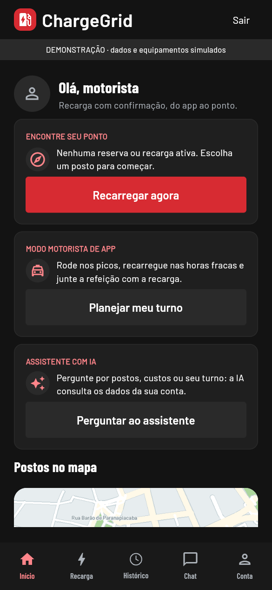
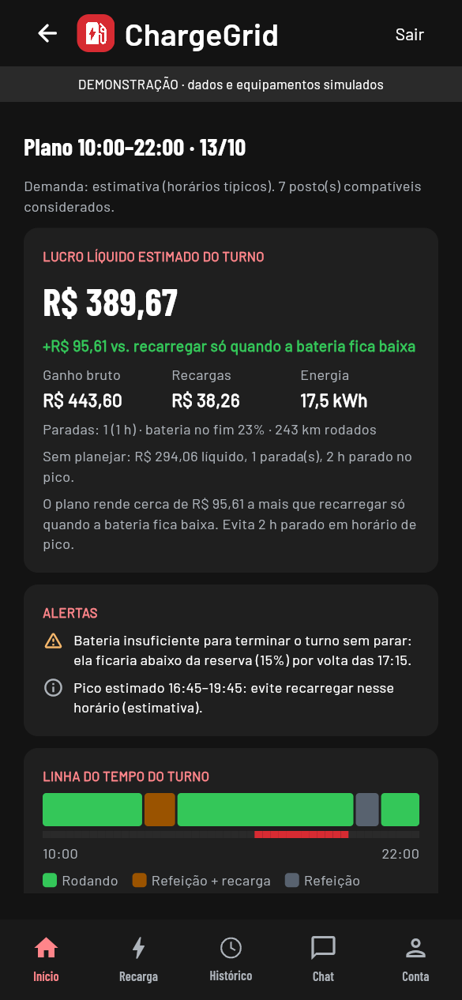
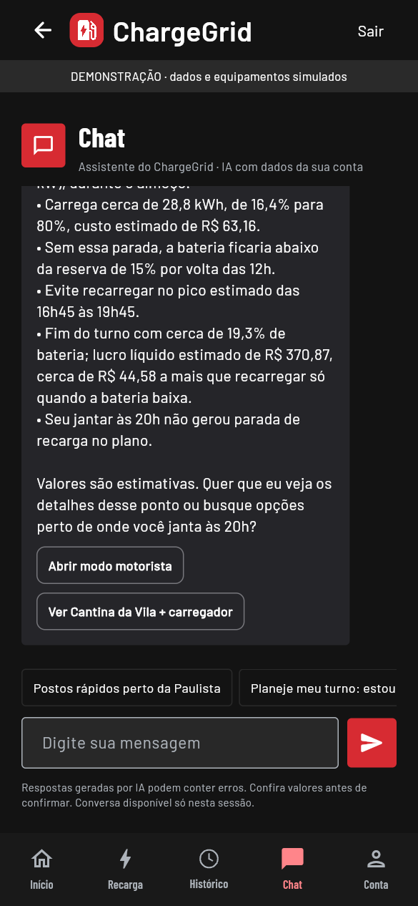
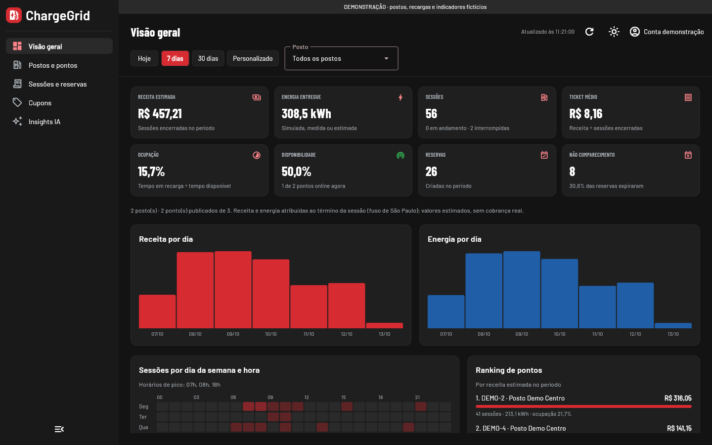
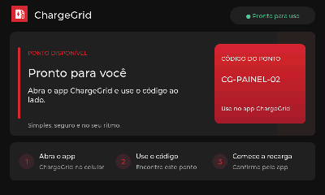
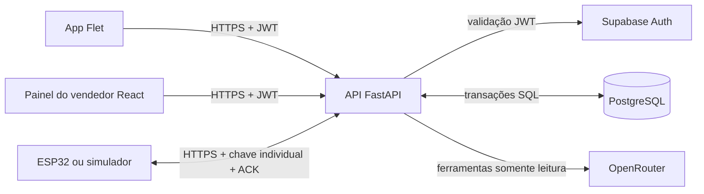
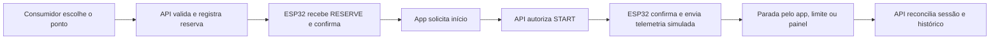

<div align="center">


# ChargeGrid

**Recarga com confirmação, do app ao ponto.**

Protótipo acadêmico da equipe **FFIVE** que integra aplicativo, dashboard web, API e painel ESP32 para demonstrar a gestão de eletropostos.

`Flet` · `FastAPI` · `PostgreSQL` · `ESP32-S3` · `LVGL` · `OpenRouter`

[Diferenciais](#diferenciais-desta-versão) · **[Painel do vendedor online](https://chargegrid-painel.vercel.app)** · [Como executar](#como-executar) · [Arquitetura](#arquitetura-e-fluxo) · [Resultados](#resultados-observados) · [Documentação técnica](#documentação-e-código)

</div>

> **Escopo da bancada:** reservas, comandos e histórico passam pelo sistema integrado. Potência, energia e SoC são gerados por `SimulatedSensors`. O protótipo não mede um veículo, não aciona um carregador e não processa pagamentos.

## Visão do projeto e versões

O ChargeGrid foi pensado para facilitar ao consumidor a busca e o acompanhamento de recargas e ao vendedor a gestão de postos e tarifas. A mesma conta pode acessar funções de consumo e, após vincular um equipamento próprio, funções de operação. A proposta busca apoiar a expansão da infraestrutura para veículos elétricos; a integração com recarga elétrica real ainda está fora do escopo deste protótipo.

Este `main` documenta a fundação integrada com app, API e painel físico. A branch **[`Simulado`](https://github.com/DJLIMA1/FIAP-ChargeGridApp-GS1-2026/tree/Simulado)** mantém a versão anterior executável localmente, com dados em JSON e README próprio, para preservar essa base e experimentar outras ideias. Consulte essa branch para as instruções específicas da versão simulada.

## O que foi construído

| Componente | Função | Código |
| --- | --- | --- |
| Aplicativo | Cadastro/login, busca de postos (também em linguagem natural), reserva, recarga em etapas, histórico com resumo inteligente, **Modo Motorista**, chat com **assistente de IA** e gestão pelo vendedor | [`apps/mobile/`](apps/mobile/) |
| Painel do vendedor (web) | Painel oficial em React, exclusivo para vendedores: KPIs, gráficos, mapa de calor, status ao vivo dos pontos, alertas, estações/tarifas/comodidades, sessões e exportação CSV/JSON, cupons e **Insights IA** | [`apps/owner-web/`](apps/owner-web/) (a versão Flet anterior segue em [`apps/dashboard/`](apps/dashboard/)) |
| API | Autenticação, autorização, regras de reserva/recarga, comandos para dispositivos, Modo Motorista, indicadores do dono e rotas de IA | [`apps/api/`](apps/api/) |
| Núcleo compartilhado | Regras puras usadas por app, dashboard e API: planejador do turno, indicadores, formatação pt-BR e o laço de IA com ferramentas somente leitura | [`packages/chargegrid_core/`](packages/chargegrid_core/) |
| Banco | Perfis, postos, pontos, reservas, sessões, dispositivos, comandos e telemetria | [`apps/api/migrations/`](apps/api/migrations/) |
| Painel ESP32 | Interface touch, sincronização HTTPS, confirmação de comandos e parada local | [`firmware/esp32/`](firmware/esp32/) |
| Simulador e ferramentas | Dispositivo simulado, provisionamento, QA e manutenção | [`tools/`](tools/) |

O vendedor vincula o equipamento por um **QR privado de propriedade**, configura localização, conector e tarifa e publica o ponto. O consumidor usa um **código público diferente** para iniciar a recarga. O sistema só considera uma ação aplicada depois da confirmação do dispositivo.

Na experiência atual, o motorista compara pontos por conector, disponibilidade, tarifa e proximidade da busca. Pode planejar por tempo ou orçamento antes de reservar e levar esses limites à revisão da recarga. O app destaca pedidos pendentes, confirmações recebidas e falhas de atualização; alterações de tarifa ou limites exigem nova revisão antes de um novo início. [Detalhes e validação da experiência →](docs/validacao-experiencia-gs.md)

## Diferenciais desta versão

| Diferencial | O que faz | Onde ver |
| --- | --- | --- |
| **Modo Motorista** | Para motoristas de app com carro elétrico: monta o turno decidindo quando, onde e quanto recarregar, evitando parar nos picos estimados de corridas e juntando a refeição com a recarga em postos com restaurante ou café. Mostra lucro líquido estimado, linha do tempo, bateria projetada e a "próxima parada agora", com reserva direto do plano. | Início → **Planejar meu turno** · [documentação](docs/modo-motorista.md) |
| **Assistente com IA** | Chat que consulta postos, estimativas, reserva, recargas e o plano do turno por ferramentas **somente leitura**; sugere botões que abrem as telas normais (reservar continua exigindo confirmação). Também há **busca em linguagem natural** na aba Recarga e **resumo inteligente** de cada recarga no Histórico. | Aba **Chat** · [documentação](docs/ia-openrouter.md) |
| **Dashboard web do proprietário** | Receita, energia, ocupação, disponibilidade, não comparecimento, picos por dia e hora, ranking, alertas, gestão de postos/tarifas/comodidades, exportação e **Insights IA** com recomendações de preço e operação. Mesma conta e mesma API do app. | [`apps/owner-web`](apps/owner-web/README.md) · [painel do vendedor online](https://chargegrid-painel.vercel.app) (entre com uma conta de vendedor) |

Sem a chave do OpenRouter, nada quebra: o chat responde com orientações locais, e a busca, o resumo e os insights usam regras determinísticas (`model = chargegrid-regras`). Demanda de corridas, consumo e custos são **estimativas**; não há dados oficiais da Uber/99.

## Protótipo visual

<table>
  <tr>
    <th>Início com os diferenciais</th>
    <th>Modo Motorista: plano do turno</th>
    <th>Assistente com IA</th>
  </tr>
  <tr>
    <td align="center"></td>
    <td align="center"></td>
    <td align="center"></td>
  </tr>
</table>

<table>
  <tr>
    <th>Dashboard web do proprietário</th>
    <th>Framebuffer capturado do painel físico</th>
  </tr>
  <tr>
    <td align="center"></td>
    <td align="center"></td>
  </tr>
</table>

As capturas do app e do dashboard foram feitas em 13/10/2026 na **conta demo da prévia web local** (dados fictícios; app em 390 × 844 e dashboard em 1440 × 900), com a IA real via OpenRouter. Também há os [Insights IA do dashboard](docs/images/dashboard-insights-ia.png) e as capturas anteriores da home ([escuro](docs/images/app-home-gs-dark.png), [claro](docs/images/app-home-gs-light.png)). A imagem do painel foi lida do framebuffer da placa conectada na versão 0.3.4; não é fotografia do LCD e não contém QR ou credenciais privadas. Mais detalhes em [painel Waveshare](docs/waveshare-panel.md).

## Arquitetura e fluxo





A API é a única camada que acessa o banco e aplica as permissões; a chave do OpenRouter também fica só nela (e no processo local da prévia demo). O ESP32 sincroniza a cada **5 s durante a recarga** e **10 s fora dela**. Se ficar **45 s sem comunicação**, a bancada encerra a sessão localmente; após reinício, uma sessão nunca recomeça sem nova autorização. [Diagramas detalhados, circuito funcional e decisões técnicas →](docs/integracao-componentes.md)

## Resultados observados

Os ensaios de integração registrados em 21/09/2026 cobriram autenticação, reserva, ACK do dispositivo, início, telemetria, parada, histórico, isolamento entre contas e limite automático de custo. Os três exemplos abaixo foram executados na **placa física**, com medições **simuladas**:

| Ensaio | Energia simulada | Custo estimado | Resultado |
| --- | ---: | ---: | --- |
| Parada solicitada pelo app | 60,392 Wh | R$ 0,0906 | `completed` |
| Parada local no dispositivo | 12,084 Wh | R$ 0,0181 | `completed` |
| Teto de R$ 0,01 | 6,666 Wh | R$ 0,0100 | `cost_limit` |

Os valores mostram o funcionamento do **modelo de controle**, não energia entregue a um carro. Evidências: [validação integrada](docs/validacao-mvp-0.2.0.md), [resultados estruturados](docs/qa-live-results.json), [primeira vinculação física](docs/validacao-0.3.2.md) e [histórico do painel](docs/waveshare-panel.md). O fluxo de restauração pelo app ainda não foi repetido fisicamente após a correção da permissão SQL, conforme o histórico do painel.

## Como executar

Requisitos: **Python 3.12** para o app, **Python 3.11** para a API e **PlatformIO** para o firmware. Copie [`.env.example`](.env.example) para `.env` na raiz e preencha os valores locais. O `.env` está ignorado pelo Git.

**Aplicativo**, na raiz do repositório:

```bash
python3.12 -m venv .venv
source .venv/bin/activate
pip install -r requirements.txt
python src/main.py
```

**API**, em outro terminal e com o banco configurado:

```bash
cd apps/api
python3.11 -m venv .venv
source .venv/bin/activate
pip install -r requirements.txt
alembic upgrade head
uvicorn app.main:app --reload
```

Para ligar a IA na API, defina `OPENROUTER_API_KEY` no ambiente (veja [variáveis](#variáveis-de-ambiente)). Antes de executar a API com o papel de banco restrito, aplique também a concessão descrita em [instalação e configuração](docs/setup.md#api-e-postgresql). Para compilar a interface da placa:

```bash
pio run -d firmware/esp32 -e waveshare_panel_ui
```

**Prévia web com a conta demo** (sem API, sem placa), na raiz:

```bash
# App (abra http://127.0.0.1:8855 e toque em "Entrar na conta demo")
PYTHONPATH=apps/mobile/src .venv/bin/python tools/preview_mobile_flows.py

# Painel do vendedor em React com dados fictícios (abra http://localhost:5199/?mock_login=1)
cd apps/owner-web && npm ci && npm run dev:mock

# Prévia Flet anterior do dashboard (abra http://localhost:8610 e entre na conta demo)
CHARGEGRID_ENABLE_DEMO=1 .venv/bin/flet run --web -p 8610 apps/dashboard/main.py
```

Com a IA real na demo, carregue a chave **só no processo**, sem imprimi-la: `set -a; source .env; set +a` antes dos comandos acima. Sem a chave, a demo funciona com orientações locais e regras.

A conta demo (`demo@chargegrid.example`, senha pública `demo1234`) exige `CHARGEGRID_ENABLE_DEMO=1`; o script de prévia define essa opção. Ela fica desligada por padrão no aplicativo, inclusive no APK de produção, e a prévia de IA local (`services/demo_ai.py`) é excluída do APK. Os dados e equipamentos dessa conta são simulados e reiniciados ao sair. Para demonstrar a integração com a API sem placa, use o [simulador de dispositivo](docs/demo.md#demonstração-integrada-com-api-e-dispositivo) com uma identidade provisionada. O [guia completo](docs/setup.md) explica banco, Auth, provisionamento por QR, APK e implantação; o [roteiro de apresentação](docs/demo.md) traz uma demonstração de 5 minutos dos diferenciais.

### Variáveis de ambiente

| Variável | Onde | Uso |
| --- | --- | --- |
| `CHARGEGRID_API_URL` | app e dashboard | URL da API (HTTPS; HTTP só em localhost) |
| `CHARGEGRID_ENABLE_DEMO` | app e dashboard | `1` liga a conta demo (somente desenvolvimento) |
| `DATABASE_URL`, `MIGRATION_DATABASE_URL` | API | PostgreSQL de execução e de migração |
| `SUPABASE_URL`, `SUPABASE_ANON_KEY` | API | autenticação |
| `CORS_ORIGINS` | API | origens web permitidas (ex.: o dashboard publicado) |
| `OPENROUTER_API_KEY` | API e prévia demo | liga a IA; vazio = regras e orientações locais |
| `OPENROUTER_MODEL`, `OPENROUTER_FALLBACK_MODELS` | API e prévia demo | modelo principal (`deepseek/deepseek-v4.1-flash`) e até 2 alternativas |
| `OPENROUTER_REASONING_EFFORT`, `AI_ENABLED` | API | esforço de raciocínio do chat; `false` desliga a IA sem remover a chave |

A escolha do modelo, o benchmark, os limites por usuário e os custos estão em [IA com OpenRouter](docs/ia-openrouter.md).

## Justificativa técnica e ligação com a disciplina

| Conteúdo aplicado | Onde aparece |
| --- | --- |
| Sistemas embarcados e IoT | ESP32-S3, touch, Wi-Fi, estados locais e watchdog |
| Redes e protocolos | HTTPS/JSON, sincronização periódica, comandos versionados e ACK |
| Banco de dados | Modelos relacionais, migrações e transações para reservas concorrentes |
| Segurança | JWT, propriedade do equipamento, chaves separadas e TLS |
| Engenharia de software | App, API e firmware em camadas, testes e contratos documentados |

As escolhas, consequências e o **diagrama do circuito funcional da bancada** estão em [integração dos componentes](docs/integracao-componentes.md). Como o LCD e o touch são integrados à placa comercial e não há circuito externo de potência, o diagrama descreve essas conexões sem inventar pinagem, relé ou sensores que não existem no protótipo.

## Documentação e código

| Tema | Link |
| --- | --- |
| Integração, fluxogramas, circuito e resultados | [Integração dos componentes](docs/integracao-componentes.md) |
| Arquitetura e segurança | [Arquitetura](docs/architecture.md) |
| Endpoints HTTP | [Contrato da API](docs/api.md) |
| Comandos e telemetria | [Protocolo ESP32](docs/esp32-protocol.md) |
| Instalação e provisionamento | [Guia de configuração](docs/setup.md) |
| Firmware e painel | [README do firmware](firmware/esp32/README.md) · [Validação do painel](docs/waveshare-panel.md) |
| Modo Motorista | [Planejamento do turno](docs/modo-motorista.md) |
| IA (chat, busca, resumos, insights) | [IA com OpenRouter](docs/ia-openrouter.md) |
| Painel do vendedor | [README do painel React](apps/owner-web/README.md) · [prévia Flet anterior](apps/dashboard/README.md) |
| Qualidade e segurança | [Auditoria de QA](docs/qa-auditoria-2026-10.md) · [Revisão de integração](docs/revisao-integracao-2026-10.md) |
| Demonstração | [Roteiro de 5 minutos e demonstração integrada](docs/demo.md) |

## Limites do APP

O painel não controla energia nem mede um veículo; os custos são estimativas. Não há processamento de pagamento. O assistente usa IA externa (OpenRouter) quando a chave está configurada: as respostas podem conter erros, as ferramentas só leem dados e nenhuma ação com efeito é executada pela IA; não é atendimento humano. A demanda do Modo Motorista é uma heurística por horário (sem dados oficiais de aplicativos de transporte), e o lucro do turno é estimado. Na demo, os indicadores do dono usam um histórico simulado de 30 dias. Confirmação de e-mail está desativada neste ambiente e a recuperação depende de SMTP próprio. APKs, firmware compilado, chaves de dispositivo, QR privado e `.env` ficam fora do repositório; os guias ensinam a gerar os artefatos. Dados e imagens publicados aqui não expõem credenciais de provisionamento.

## Vídeo da demonstração física:

https://youtu.be/mkwz-fn6H5c

# Vídeo Técnico da demonstração simulada:

https://youtu.be/NDLEdLEj1QY


## Equipe FFIVE

| Integrante | RM |
| --- | ---: |
| Augusto de Souza Ávila | 570839 |
| Davi Simoncelo | 571738 |
| João Pedro Sousa | 573962 |
| Matheus Evangelista Silva | 568593 |
| Murilo Lima de Carvalho | 570156 |
