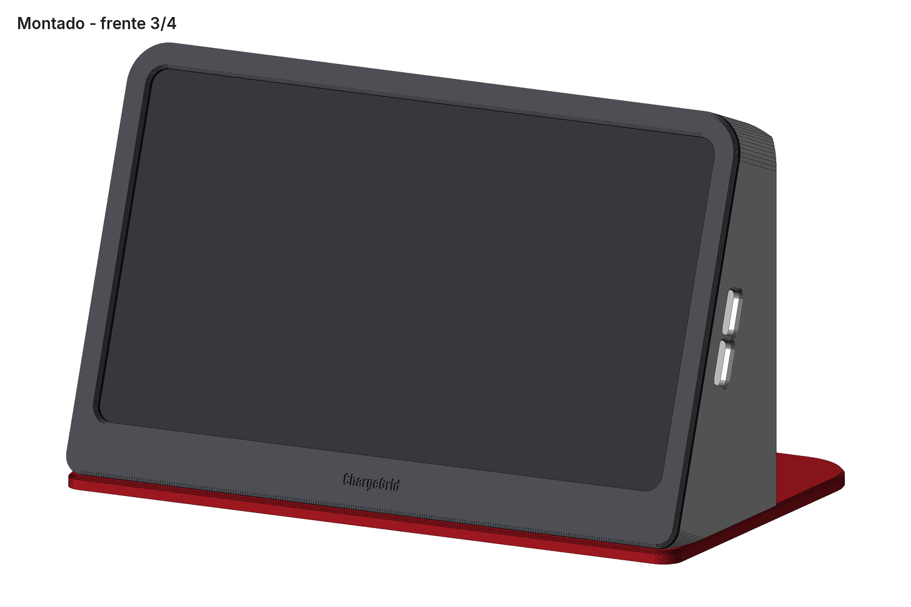
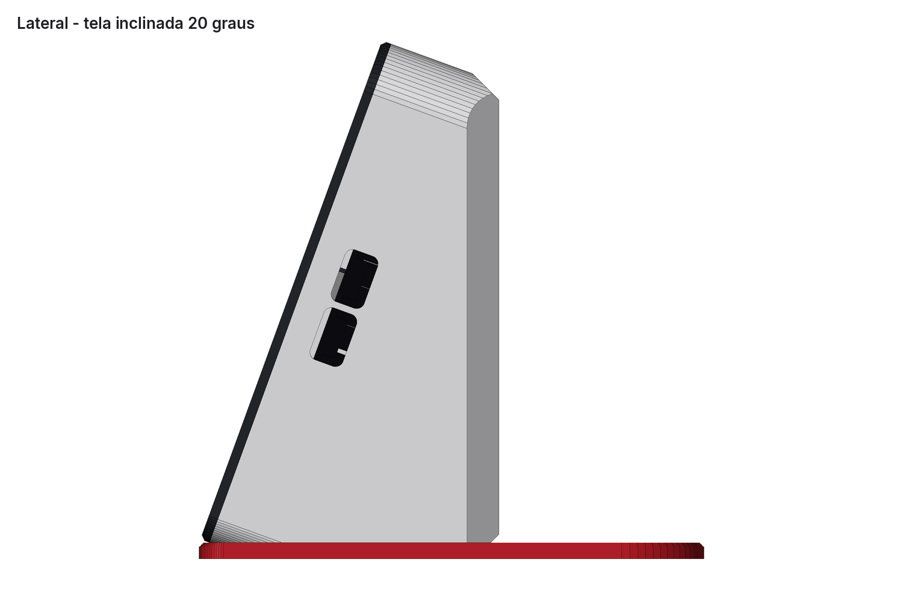
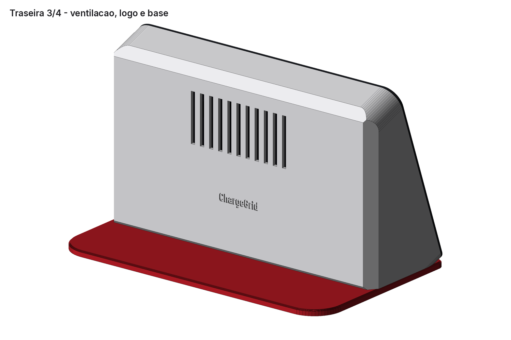
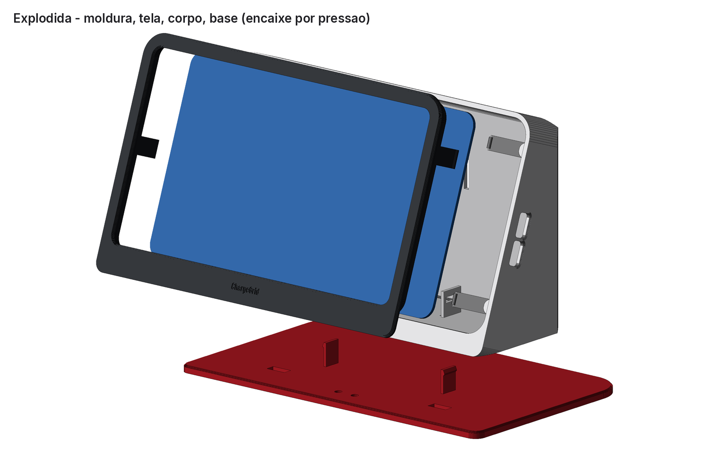
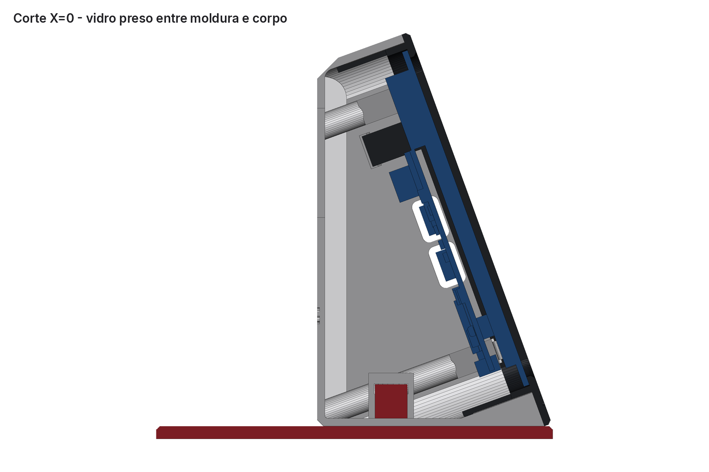
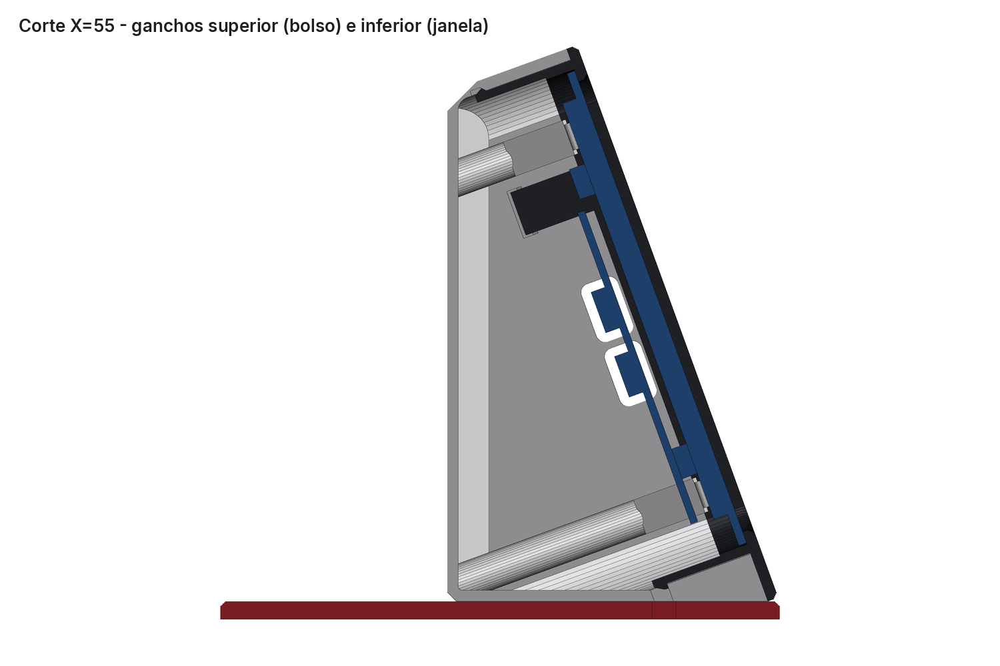
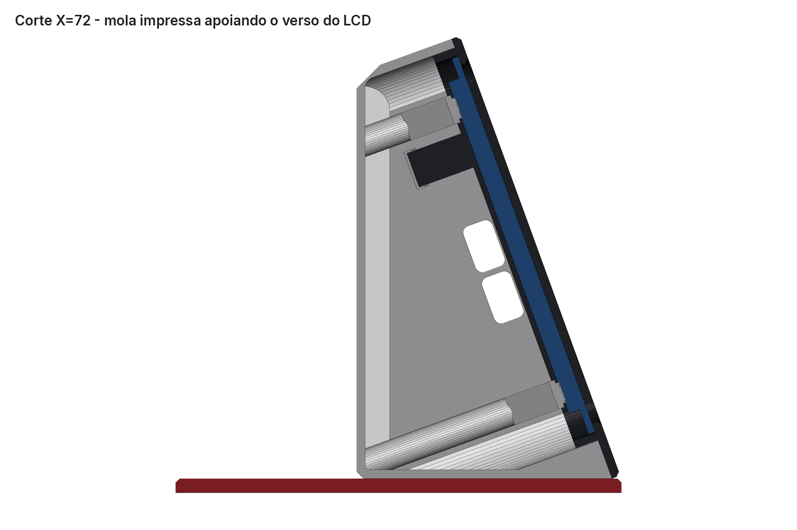
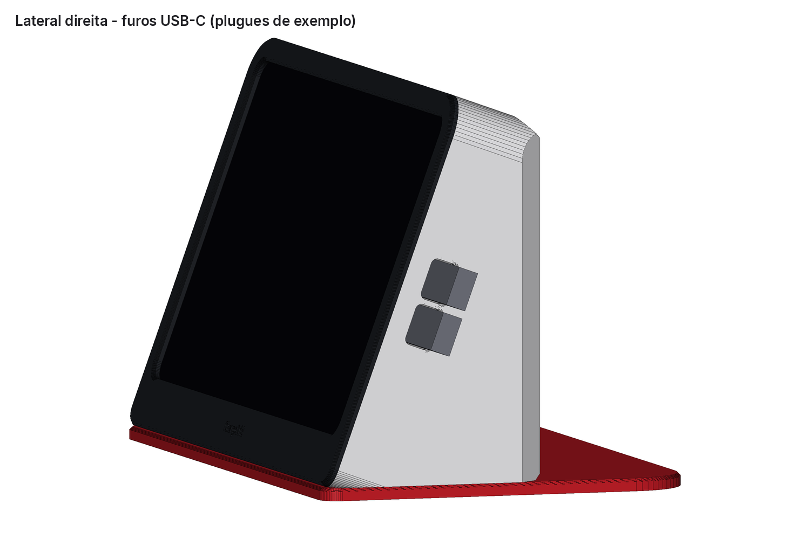

# Case inclinado para a tela Waveshare ESP32-S3-Touch-LCD-7

Case de mesa, impresso em 3D, para a placa usada no painel do posto (ESP32-S3-Touch-LCD-7, **com touch**, 800 × 480; ver [painel](../waveshare-panel.md)). É uma cunha grossa, com a tela inclinada 20° para trás. **Nenhum parafuso une as peças**: elas se encaixam por pressão. Os suportes M3 originais da tela ficam livres; o case não precisa deles.



| Lateral | Traseira |
| --- | --- |
|  |  |

## Medidas da tela

A documentação do repositório citava apenas o modelo. As medidas abaixo vêm do material oficial da Waveshare: [wiki](https://www.waveshare.com/wiki/ESP32-S3-Touch-LCD-7), [desenho com touch](https://www.waveshare.com/w/upload/e/e8/ESP32-S3-Touch-LCD-7-details-size-2.png) e [pacote 3D (PDF + STEP)](https://files.waveshare.com/wiki/ESP32-S3-Touch-LCD-7/ESP32-S3-Touch-LCD-7in0_Drawing.zip). As caixas dos componentes da PCB, extraídas do STEP, ficam em [`referencia/pcb-componentes-step.json`](referencia/pcb-componentes-step.json).

| Item | Medida (mm) |
| --- | --- |
| Vidro touch (contorno) | 192,96 × 110,76, cantos R7,88 |
| Área ativa | 154,88 × 86,72; bordas pretas de 19,04 nas laterais, 13,04 em cima e 11,00 embaixo |
| Vidro + LCD | 5,00 de espessura |
| Quadro metálico do LCD (verso) | 165,72 × 97,60 |
| Suportes M3 (4, com porca) | 126,20 × 65,65 entre centros |
| PCB | 106,01 × 73,01; face voltada ao LCD a 8,5 da frente do vidro |
| Profundidade total | 18,4 da frente do vidro até o topo dos conectores mais altos |
| Portas (vista de frente) | dois USB-C na lateral **direita**: em cima **UART1**, embaixo **USB**; botões RESET e BOOT na borda inferior da PCB |

## Peças

| Arquivo | Peça | Tamanho na mesa (mm) | Volume |
| --- | --- | --- | --- |
| `stl/00-TESTE-encaixe-moldura.stl` | cupom de teste da moldura (2 tiras) | 26 × 130 × 25 | 2,7 cm³ |
| `stl/00-TESTE-encaixe-corpo.stl` | cupom de teste do corpo (2 tiras) | 26 × 130 × 25 | 5,7 cm³ |
| `stl/01-MOLDURA-frente.stl` | moldura frontal, segura o vidro | 203,4 × 129,7 × 24,9 | 24,1 cm³ |
| `stl/02-CORPO-cunha.stl` | corpo em cunha | 203,4 × 121,9 × 70,7 | 151,7 cm³ |
| `stl/03-BASE-apoio.stl` | base de apoio (recomendada) | 203,4 × 123,2 × 17 | 98,6 cm³ |

O case montado mede 203,4 mm de largura, 121,9 mm de altura sobre a mesa (126 mm com a base) e 30,4 mm de espessura no topo, incluindo a moldura. A base ocupa 123 mm de profundidade.

## Como funciona o encaixe



- **Moldura → vidro:** o vidro entra num bolso com 0,35 mm de folga por lado. Um lábio de 2,5 mm cobre a borda preta do vidro e não chega à área ativa.
- **Corpo → tela:** seis molas impressas (dedos a 50° com ressalto arredondado) empurram o verso metálico do LCD com 0,4 mm de pré-carga, cerca de 2 a 3 N cada. Elas evitam a PCB, os suportes M3 e os cabos flexíveis.
- **Moldura → corpo:** seis ganchos de 16 mm. Os **dois de baixo** travam a 90° em janelas no fundo do corpo e soltam com uma chave de fenda. Os **dois de cima e os dois laterais** ficam escondidos em bolsos com rampa de 45°: seguram a moldura, mas soltam quando se puxa com firmeza.
- **Base → corpo:** dois ganchos sobem pelo piso do corpo e entram em janelas de nervuras internas, também com rampa de 45°. A base sai puxando.

| Corte no centro | Ganchos | Molas |
| --- | --- | --- |
|  |  |  |

## Impressão (Ender-3, PLA, bico 0,4)

Os STL já estão na orientação de impressão e **não precisam de suporte**: a moldura imprime com a frente na mesa, o corpo com as costas na mesa e a base deitada. As arestas que tocam a mesa têm chanfros de 45° em vez de arredondamentos. Ficam apenas pontes curtas, como as janelas dos ganchos, os rebaixos das letras e os pés.

Sugestão de perfil: camada de 0,2 mm, 4 perímetros, 5 camadas no topo e no fundo, preenchimento de 20% (giroide ou grade), mesa a 60 °C e brim de 3 mm no corpo e nos cupons. A largura de 203,4 mm cabe na mesa de 220 × 220, mas sobra pouca margem para a saia do fatiador. Use só brim, ou uma saia bem próxima da peça.

Ordem recomendada:

1. **Cupons de teste** (cerca de 1 h). Encaixe a tira da moldura na do corpo. Os dois ganchos devem clicar sem esforço exagerado: o de cima solta puxando, o de baixo só solta empurrando o dente pela janela. Se ficar duro, aumente `clr_fit` em `gerar.py` (folga entre saia e corpo; padrão de 0,25 mm) e gere de novo.
2. **Moldura.** Antes de imprimir o corpo, confira se o vidro entra com folga leve.
3. **Corpo.**
4. **Base.** Cole pés de borracha de 10 mm nos rebaixos.

## Montagem

1. Coloque a moldura de frente para baixo sobre um pano e encaixe a tela com o vidro para baixo. O lado dos conectores USB-C fica à direita de quem olha a frente da tela.
2. Desça o corpo sobre a moldura, com a abertura para baixo, alinhando os furos USB-C laterais com as portas. Pressione até ouvir os seis cliques. As molas encostam no verso do LCD no final do curso.
3. Encaixe a base por baixo do corpo até os dois ganchos clicarem.
4. Passe o cabo USB-C pelo furo lateral **de baixo (USB)** ou **de cima (UART1)**. O plugue percorre cerca de 44 mm até a porta; o furo serve de guia. Plugues de até 12,5 × 6,5 mm passam com folga.

Por baixo há dois furos de pino: RESET (à direita, vista de frente) e BOOT (à esquerda). Eles alcançam os botões com um clipe de papel, mesmo com a base, que tem furos coincidentes. Para tirar a tela, retire a base puxando, solte os dois ganchos inferiores pelas janelas do fundo e puxe a moldura para a frente. O cartão microSD só fica acessível com o case aberto.



## Verificação digital

`gerar.py` reconstrói todas as peças e grava os resultados em `parametros.json`, em `verificacao`:

- Moldura × corpo, tela × moldura, tela × corpo, plugues USB-C × case e base × corpo/tela: **0 mm³** de interferência. Os únicos contatos com a tela são os ressaltos das molas (pré-carga intencional).
- Folga mínima entre o corpo e a tela/PCB, sem contar as molas: 0,55 mm.
- Cinco peças estanques, em um corpo cada (os cupons têm duas tiras). Todas cabem na mesa da Ender-3.
- Análise de balanço: nenhuma face pior que 45° fora as pontes de cerca de 11 mm das janelas.
- Estabilidade de um toque perpendicular ao vidro, com massa estimada de 230 g para a tela:

  | Situação | Toque no centro | Toque no topo da área ativa |
  | --- | --- | --- |
  | sem a base | tomba com 2,9 N | tomba com 1,5 N |
  | com a base (pivô nos pés de borracha traseiros) | tomba com 8,4 N | tomba com 3,9 N |

  Um toque capacitivo comum tem cerca de 0,5 a 1 N. Sem a base o case fica em pé, mas pode balançar com toques firmes no topo. Por isso a base é recomendada.

## Limitações e o que conferir na peça física

- **Nada foi impresso ainda.** Folgas, pré-carga das molas e força dos ganchos são valores de projeto para PLA e dependem da calibração da impressora. Os cupons existem para validar isso antes.
- A pré-carga de 0,4 mm usa a espessura vidro + LCD de 5,00 mm do desenho oficial. Se a tela ficar solta, reduza `spring_preload`; se ficar apertada demais, aumente.
- A altura dos suportes M3 no verso não aparece no desenho. Usei um envelope estimado de até 8,6 mm atrás do vidro e mantive as molas e os postes afastados deles.
- A massa da tela é estimada (230 g), e a estabilidade depende dela.

## Regenerar

```bash
pip install numpy trimesh manifold3d matplotlib pillow
```

```bash
python gerar.py
```

```bash
python renderizar.py
```

Todos os parâmetros ficam no dicionário `P` no início de `gerar.py`: inclinação, folgas, espessuras, queixo, molas, ganchos e base. Para estudos sem editar o arquivo, use `CASE_PARAMS='{"tilt_deg": 15}' python gerar.py`.
