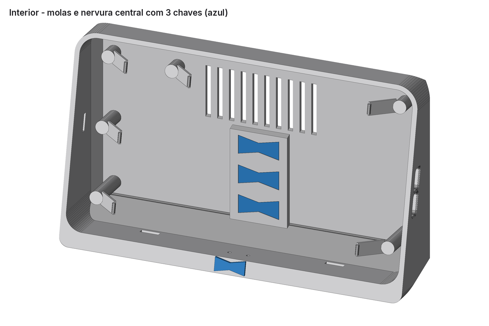
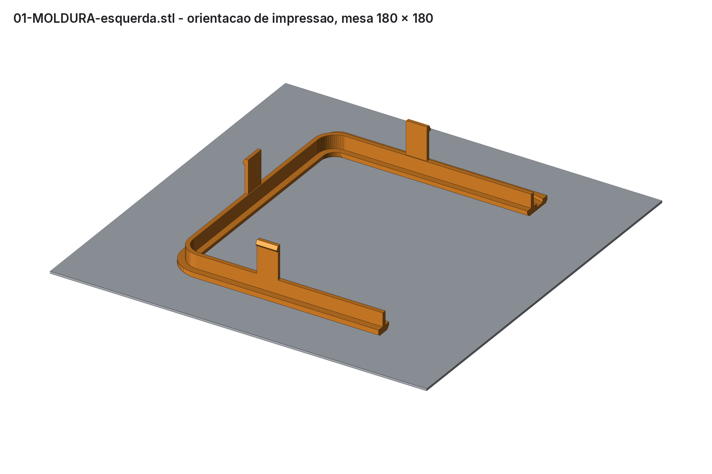
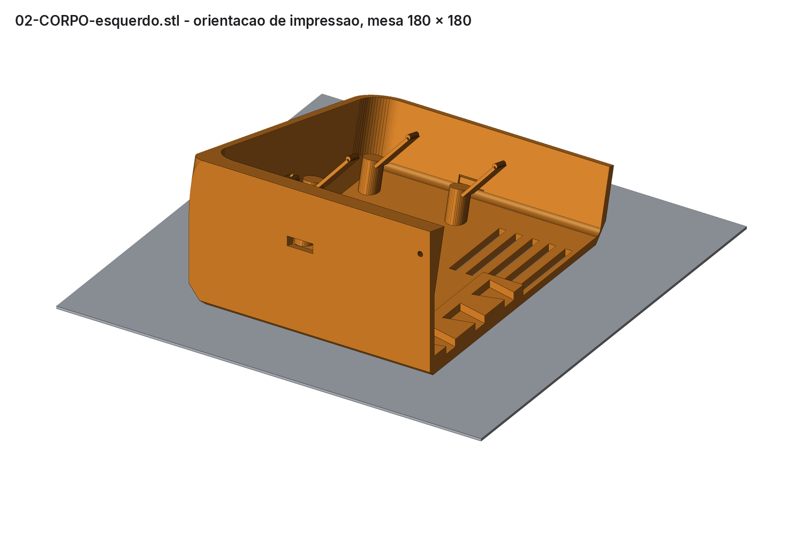
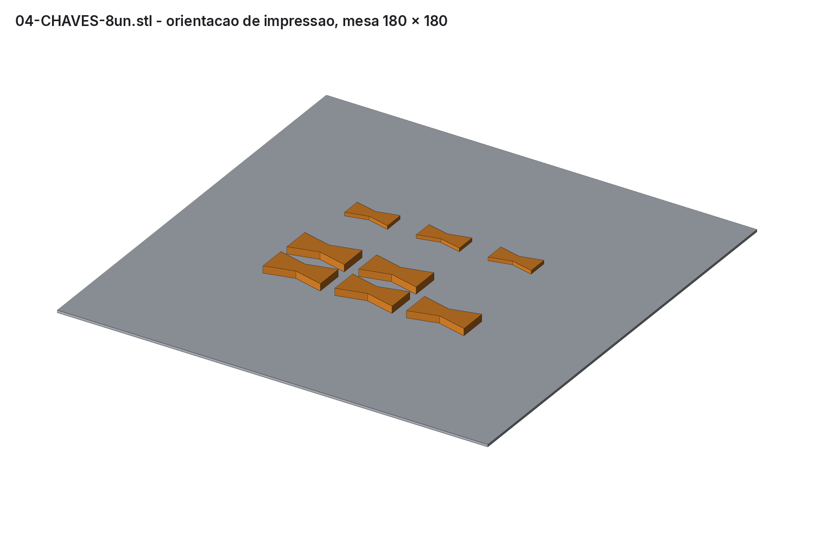
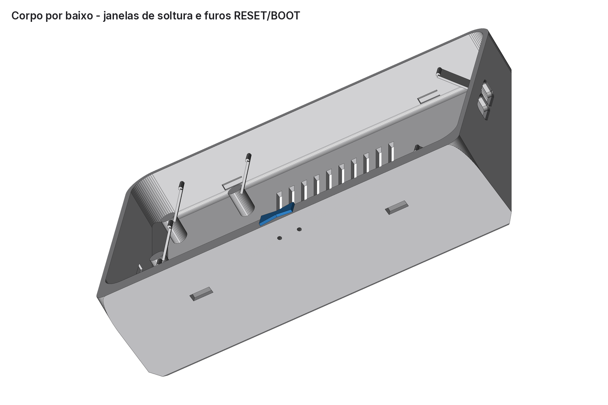

# Case inclinado para a tela Waveshare ESP32-S3-Touch-LCD-7

Case de mesa, impresso em 3D, para a placa usada no painel do posto (ESP32-S3-Touch-LCD-7, **com touch**, 800 × 480; ver [painel](../waveshare-panel.md)). É uma cunha grossa, com a tela inclinada 15° para trás, superfícies lisas e **sem nome ou logotipo**. O corpo apoia direto na mesa, sem placa estendida para trás. **Nenhum parafuso une as peças**: elas se encaixam por pressão, chaves borboleta impressas e cola. Os suportes M3 originais da tela ficam livres.

**Para imprimir na faculdade:** envie a pasta [`entrega-faculdade/`](entrega-faculdade/) ou o arquivo [`ChargeGrid-Case-Tela7-Faculdade-v2.zip`](ChargeGrid-Case-Tela7-Faculdade-v2.zip). Ela contém os 7 STL, as [configurações de impressão](entrega-faculdade/CONFIGURACOES-DE-IMPRESSAO.txt) e o [texto para o laboratório](entrega-faculdade/LEIA-ANTES-DE-ENVIAR.txt).


| Lateral | Traseira |
| --- | --- |
|  |  |

## Medidas da tela

A documentação do repositório citava apenas o modelo. As medidas abaixo vêm do material oficial da Waveshare: [wiki](https://www.waveshare.com/wiki/ESP32-S3-Touch-LCD-7), [desenho com touch](https://www.waveshare.com/w/upload/e/e8/ESP32-S3-Touch-LCD-7-details-size-2.png) e [pacote 3D (PDF + STEP)](https://files.waveshare.com/wiki/ESP32-S3-Touch-LCD-7/ESP32-S3-Touch-LCD-7in0_Drawing.zip). As caixas dos componentes da PCB, extraídas do STEP, ficam em [`referencia/pcb-componentes-step.json`](referencia/pcb-componentes-step.json).

| Item | Medida (mm) |
| --- | --- |
| Vidro touch (contorno) | 192,96 × 110,76, cantos R7,88 |
| Área ativa | 154,88 × 86,72; bordas pretas de 19,04 nas laterais, 13,04 em cima e 11,00 embaixo |
| Vidro + LCD | 5,00 de espessura |
| Quadro metálico do LCD (verso) | 165,72 × 97,60 |
| Suportes M3 (4, com porca) | 126,20 × 65,65 entre centros |
| PCB | 106,01 × 73,01; face voltada ao LCD a 8,5 da frente do vidro |
| Profundidade total | 18,4 da frente do vidro até o topo dos conectores mais altos |
| Portas (vista de frente) | dois USB-C na lateral **direita**: em cima **UART1**, embaixo **USB**; botões RESET e BOOT na borda inferior da PCB |

## Peças

O case montado mede 204 mm de largura e não cabe inteiro numa impressora de 180 × 180 × 180 mm, o limite informado pela faculdade. Por isso a moldura e o corpo são divididos em metades no centro. A maior medida de qualquer arquivo é 129 mm.

| Arquivo | Peça | Tamanho (mm) | Volume |
| --- | --- | --- | --- |
| `00-TESTE-encaixe-moldura.stl` | 2 tiras de teste da moldura | 26 × 129 × 26 | 2,9 cm³ |
| `00-TESTE-encaixe-corpo.stl` | 2 tiras de teste do corpo | 26 × 129 × 25 | 5,9 cm³ |
| `01-MOLDURA-esquerda.stl` / `-direita` | moldura frontal, segura o vidro | 102 × 129 × 26 cada | 13,6 cm³ cada |
| `02-CORPO-esquerdo.stl` / `-direito` | corpo em cunha | 102 × 125 × 60 cada | 88,7 + 85,8 cm³ |
| `04-CHAVES-8un.stl` | 8 chaves borboleta: 3 + 2 reservas para o corpo (3 mm), 1 + 2 reservas para a moldura (1,5 mm) | 84 × 58 × 3 | 3,8 cm³ |

As paredes principais têm 3 mm, conforme a recomendação do laboratório. Ficam mais finas de propósito as partes que flexionam ou encaixam: ganchos (1,6 mm), molas (1,2 mm), saia da moldura (2 mm) e chaves (1,5 e 3 mm).

Montado, o case mede 204 mm de largura, 125 mm de altura, 31 mm de espessura no topo (com a moldura) e 63 mm de profundidade na base.

## Como a tela fica presa


- **Moldura → vidro:** o vidro entra num bolso com 0,35 mm de folga por lado. Um lábio de 2,5 mm cobre a borda preta do vidro e não chega à área ativa.
- **Corpo → tela:** seis molas impressas (dedos a 50° com ressalto arredondado) empurram o verso metálico do LCD com 0,4 mm de pré-carga, cerca de 2 a 3 N cada. A tela fica prensada entre o lábio da moldura e as molas, sem parafusos. As molas evitam a PCB, os suportes M3 e os cabos flexíveis.
- **Moldura → corpo:** seis ganchos de 16 mm. Os **dois de baixo** travam a 90° em janelas no fundo do corpo e soltam com uma chave de fenda. Os **dois de cima e os dois laterais** ficam escondidos em bolsos com rampa de 45°: seguram a moldura, mas soltam quando se puxa com firmeza.
- **Metades:** chaves borboleta impressas, coladas nas cavidades que atravessam a emenda central. O corpo tem 3 chaves numa nervura da parede traseira, por dentro. A moldura tem 1 chave no verso do queixo. Nenhuma aparece por fora.

| Interior e chaves | Corte no centro | Molas |
| --- | --- | --- |
|  |  |  |

## Impressão

Configurações completas em [`CONFIGURACOES-DE-IMPRESSAO.txt`](textos-entrega/CONFIGURACOES-DE-IMPRESSAO.txt). Em resumo:

- **Material:** PLA, bico 0,4 mm.
- **Qualidade:** camada de 0,2 mm, 4 paredes, 5 camadas no topo e no fundo, preenchimento de 20% (as chaves com 100%).
- **Suporte:** nenhum. Um suporte automático encheria os ganchos e os encaixes.
- **Orientação:** como entregue; não girar as peças.
- **Adesão:** brim de 5 mm no corpo e nos testes.
- **Filamento:** cerca de 240 g de PLA no total.

Os STL já estão na orientação de impressão: a moldura com a frente na mesa, o corpo com as costas na mesa e as chaves deitadas. Nenhuma face passa de 45° de balanço; existem só pontes curtas, de até 11 mm. As arestas que tocam a mesa têm chanfros de 45° em vez de arredondamentos.

| Moldura | Corpo | Chaves |
| --- | --- | --- |
|  |  |  |

Se possível, imprima primeiro os dois arquivos **00-TESTE** (cerca de 1 h). Encaixe a tira da moldura na do corpo: o gancho de cima deve soltar puxando, e o de baixo só deve soltar empurrando o dente pela janela. Se ficar duro, aumente `clr_fit` em `gerar.py` (folga entre saia e corpo; padrão de 0,25 mm) e gere de novo.

## Montagem

1. **Corpo:** encaixe as 3 chaves grossas (3 mm) na nervura central de uma metade, sem cola, e apresente a outra metade para conferir. Depois passe cola instantânea (cianoacrilato) ou epóxi nas chaves e nas faces da emenda, una as metades sobre uma mesa plana e segure até firmar.
2. **Moldura:** coloque as duas metades de frente para baixo sobre uma mesa plana, com a chave fina (1,5 mm) no verso do queixo. Confira o alinhamento encaixando a tela **a seco**, retire a tela e só então cole a emenda e a chave. Não deixe cola escorrer para o bolso do vidro.
3. Com tudo seco, coloque a moldura de frente para baixo sobre um pano e encaixe a tela com o vidro para baixo. O lado dos conectores USB-C fica à direita de quem olha a frente da tela.
4. Desça o corpo sobre a moldura, com a abertura para baixo, alinhando os furos USB-C laterais com as portas. Pressione até ouvir os seis cliques.
5. Passe o cabo USB-C pelo furo lateral **de baixo (USB)** ou **de cima (UART1)**. O plugue percorre cerca de 44 mm até a porta; o furo serve de guia. Plugues de até 12,5 × 6,5 mm passam com folga.
6. Opcional: cole pés de borracha ou silicone por baixo para o case não escorregar.

Por baixo há dois furos de pino: RESET (à direita, vista de frente) e BOOT (à esquerda). Eles alcançam os botões com um clipe de papel. Para tirar a tela, solte os dois ganchos inferiores pelas janelas do fundo e puxe a moldura para a frente. O cartão microSD só fica acessível com o case aberto.

| Furos USB-C | Por baixo |
| --- | --- |
|  |  |

## Verificação digital

`gerar.py` reconstrói todas as peças e grava os resultados em `parametros.json`, em `verificacao`:

- **Interferência zero (0 mm³):** moldura × corpo, tela × moldura, tela × corpo, plugues USB-C × case, chaves × peças/tela e entre as tiras de teste. Os únicos contatos com a tela são os ressaltos das molas, por causa da pré-carga intencional.
- **Folga mínima** entre o corpo e a tela/PCB, sem contar as molas: 0,55 mm.
- **Arquivos gravados:** os 7 STL são estanques e não têm triângulos nulos. A maior medida é 129 mm, dentro do limite de 180 mm. O [`CONFERENCIA.json`](entrega-faculdade/CONFERENCIA.json) traz o SHA-256 de cada arquivo.
- **Estabilidade** contra um toque perpendicular ao vidro, com massa estimada de 230 g para a tela: o case tomba para trás com 2,3 N no centro da tela e com 1,3 N no topo da área ativa. Um toque capacitivo comum tem cerca de 0,5 a 1 N. Com 12° esses valores caem para 1,9 e 1,1 N; com 10°, para 1,7 e 1,0 N.

## Limitações e o que conferir na peça física

- **Nada foi impresso ainda.** Folgas, pré-carga das molas e força dos ganchos são valores de projeto para PLA e dependem da impressora. Os testes 00 existem para validar isso.
- **Toques firmes no topo podem balançar o case,** porque não há placa de apoio atrás. Se isso incomodar, cole pés antiderrapantes ou ponha um peso por dentro, no fundo. A base traseira continua disponível em `gerar.py` (`usar_base=True`): com ela, o case só tomba com 3,3 N no topo e 6,3 N no centro, mas ficou fora por escolha estética.
- **Emendas:** na frente, as emendas da moldura ficam no centro do topo e do queixo. Com a cola, viram uma linha fina; se quiser, lixe e pinte.
- **Pré-carga das molas:** 0,4 mm, calculada com a espessura vidro + LCD de 5,00 mm do desenho oficial. Se a tela ficar solta, reduza `spring_preload`; se ficar apertada demais, aumente.
- **Suportes M3:** a altura deles no verso não aparece no desenho. Usei um envelope estimado de até 8,6 mm atrás do vidro e mantive as molas e os postes afastados.
- **Massa da tela:** é estimada (230 g), e a estabilidade depende dela.

## Regenerar

```bash
pip install numpy trimesh manifold3d pillow
```

```bash
python gerar.py
```

```bash
python renderizar.py
```

```bash
python preparar_entrega.py
```

Todos os parâmetros ficam no dicionário `P` no início de `gerar.py`: inclinação (`tilt_deg`, hoje 15°), folgas, espessuras, queixo, molas, ganchos, chaves e a base opcional. Para estudos sem editar o arquivo, use `CASE_PARAMS='{"tilt_deg": 12}' python gerar.py`. Os textos do pacote ficam em `textos-entrega/`.
