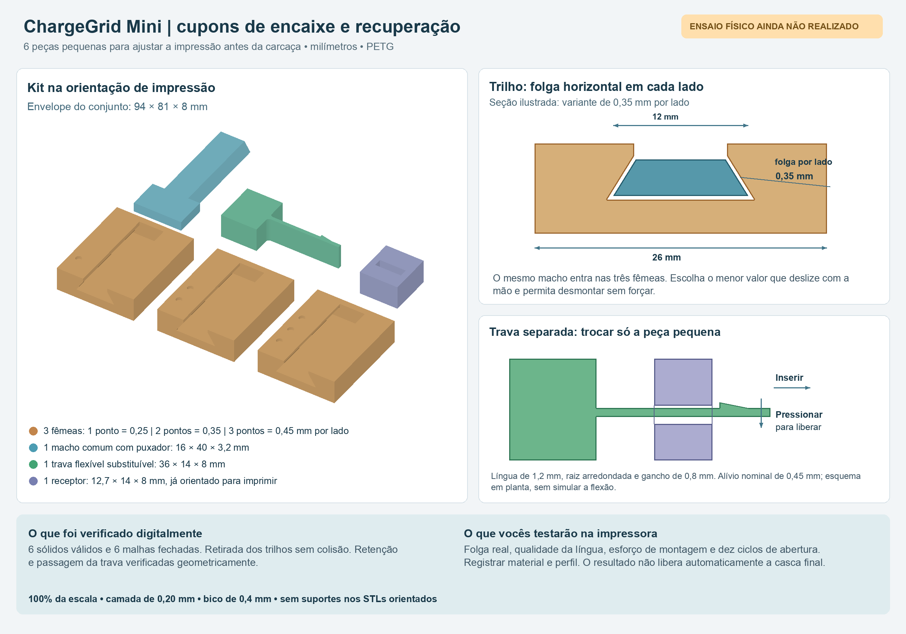

# Cupons de encaixe — ChargeGrid Mini

Kit real de seis peças pequenas para testar folgas e uma trava substituível antes de imprimir a carcaça. **A geometria foi verificada digitalmente; nenhum ensaio físico foi realizado. Estes arquivos não são as peças finais do carregador.** O kit não depende da furação ou do fornecedor da placa ESP32 WROOM.



## Arquivos para imprimir

Abrir **`stl/kit-completo-6-pecas.stl`** no fatiador, em milímetros e **100% da escala**. Ele reúne as seis peças separadas num espaço de **94 × 81 × 8 mm**. Os arquivos individuais ficam em `stl/`; os sólidos editáveis ficam em `step/`.

| Peça | Quantidade | Envelope X × Y × Z, mm | Identificação |
|---|---:|---|---|
| Fêmea do trilho, 0,25 mm por lado | 1 | 26 × 32 × 8 | Um ponto rebaixado |
| Fêmea do trilho, 0,35 mm por lado | 1 | 26 × 32 × 8 | Dois pontos rebaixados |
| Fêmea do trilho, 0,45 mm por lado | 1 | 26 × 32 × 8 | Três pontos rebaixados |
| Macho comum com puxador | 1 | 16 × 40 × 3,2 | Peça comprida, sem pontos |
| Trava flexível separada | 1 | 36 × 14 × 8 | Pega larga e língua fina |
| Receptor da trava | 1 | 12,7 × 14 × 8 | Bloco com túnel |

Não imprimir `step/montagens-DEMONSTRACAO-nao-imprimir.step`: ele mostra peças montadas, com folgas e orientação de uso. Não é uma disposição de impressão.

## Perfil inicial

- PETG, bico de 0,4 mm, camada de 0,20 mm, três paredes e 25% de preenchimento como ponto de partida.
- Manter as orientações fornecidas. O receptor já está girado para imprimir o túnel na vertical. O trilho usa flancos inclinados; o kit foi desenhado para dispensar suportes nessas orientações.
- Usar a temperatura, refrigeração e adesão apropriadas ao filamento e à impressora. Esses valores dependem do equipamento.
- Conferir no fatiador se a língua de 1,2 mm recebe linhas contínuas, sem trechos omitidos. Ajustar largura de linha ou geração de paredes conforme necessário, sem escalar o modelo.
- Remover apenas fios soltos e rebarba de primeira camada. Não lixar as faces de encaixe antes de registrar o resultado: isso alteraria o ensaio de tolerância.

O volume geométrico somado é aproximadamente 19,68 cm³. Massa e duração reais dependem do fatiamento; não foram calculadas por um fatiador nesta entrega.

## Ensaio dos trilhos

1. Deixar as peças esfriarem. Conferir com paquímetro, se disponível, a largura de 12 mm da base do macho, evitando confundi-la com o puxador de 16 mm.
2. Inserir a ponta sem puxador pela extremidade aberta de cada fêmea. A extremidade oposta tem batente; o puxador permanece para fora.
3. Começar pela fêmea de três pontos (0,45 mm) e seguir para dois e um ponto. Deslizar e retirar usando apenas as mãos; não forçar um encaixe preso.
4. Anotar para cada variante: entra completamente, desliza sem travar, tem movimento lateral perceptível e sai sem dano.
5. Escolher a menor folga que permita o movimento desejado sem forçar. Repetir dez ciclos e observar marcas, rachaduras e aumento de folga.

**“Por lado” significa folga horizontal em cada flanco**, não afastamento perpendicular à face inclinada. A folga inferior usa o mesmo valor. Como os flancos retêm a peça, existe pequeno movimento vertical antes do contato; o projeto não pressupõe encaixe sem movimento. O cupom tem 30 mm de curso; um trilho longo ou outra orientação de impressão ainda exigirá validação própria.

## Ensaio da trava substituível

A trava e o receptor são cupons manuais independentes. A pega larga permite segurar a língua; **a interface de fixação dessa pega à futura casca ainda não foi desenhada**. Assim, podemos validar e substituir a peça flexível sem refazer os trilhos ou a carcaça.

1. Girar o receptor depois de impresso para deixar o túnel alinhado à língua. Segurar a pega e introduzir a ponta fina pelo túnel, conforme o esquema.
2. O chanfro do gancho deve flexionar a língua lateralmente durante a inserção. Depois que o gancho passa pela saída do receptor, sua face traseira retém a retirada.
3. Para soltar, pressionar a extremidade livre lateralmente, afastando o gancho da parede de retenção; retirar enquanto mantém essa pressão. Não dobrar para cima, não torcer e não ultrapassar o necessário para liberar.
4. Repetir dez ciclos. Registrar se o gancho volta à posição, se o encaixe ainda retém e se apareceram marcas de tensão ou fissura na raiz.

Parâmetros iniciais: língua de 1,2 mm, largura extrudada de 8 mm, raio de raiz de 1 mm e gancho de 0,8 mm. O receptor deixa 0,35 mm no lado do gancho, resultando em **0,45 mm de deflexão nominal necessária**. O ensaio geométrico usou um envelope deslocado 0,6 mm para conferir a passagem. Ele não simula a deformação elástica real. Força, fadiga, fluência e funcionamento com o material impresso permanecem pendentes.

Se a trava ficar rígida, frágil ou não voltar à posição, alterar o parâmetro e reimprimir somente a trava. Se o túnel estiver inadequado, reimprimir somente o receptor. Não escolher um encaixe na base da força.

## Verificações realizadas

`manifesto-verificacao.json` registra os resultados e hashes dos STLs:

- Seis sólidos BRep válidos, cada um exportado em STEP e lido de volta.
- Seis malhas com volume positivo, sem triângulos degenerados, sem bordas abertas ou não manifold e com orientação consistente.
- Trilhos montados sem volume de interseção. Retirada em posições intermediárias sem colisão. Tentativas de levantar 2 mm ou avançar 0,5 mm além da posição final produzem interseções, coerentes com retenção e batente.
- Trava montada sem interseção e retida no teste geométrico de retirada sem liberação. Um envelope lateralmente deslocado atravessa o receptor sem colisão.

Esses testes conferem a geometria nominal. Não representam teste físico, análise estrutural por elementos finitos, ensaio térmico ou confirmação de que uma impressora produzirá a folga especificada. Os resultados não liberam automaticamente encaixes finais do carregador.

## Ajustar e regenerar

Editar `parametros-cupons.json` e executar os scripts com Python 3, `numpy`, `cadquery-ocp` e `Pillow` já disponíveis no ambiente utilizado. Não instalar nada automaticamente.

```sh
python gerar-cupons.py
python renderizar-cupons.py
```

O primeiro script gera os STEP/STL e para se as verificações geométricas falharem. O segundo produz o guia a partir das malhas CAD efetivas e dos parâmetros. O arquivo `malhas-para-preview.npy` é uma saída local do gerador usada apenas na visualização.

Preencher `registro-ensaio.json` após imprimir. Conservar o perfil do fatiador junto com o registro, para repetir as mesmas condições nas próximas peças.

Referências de projeto já usadas no plano: [Prusa — tolerâncias e orientação](https://help.prusa3d.com/article/modeling-with-3d-printing-in-mind_164135), [Prusa — PETG](https://help.prusa3d.com/article/petg_2059), [Protolabs Network — travas de encaixe](https://www.hubs.com/knowledge-base/how-design-snap-fit-joints-3d-printing/).
