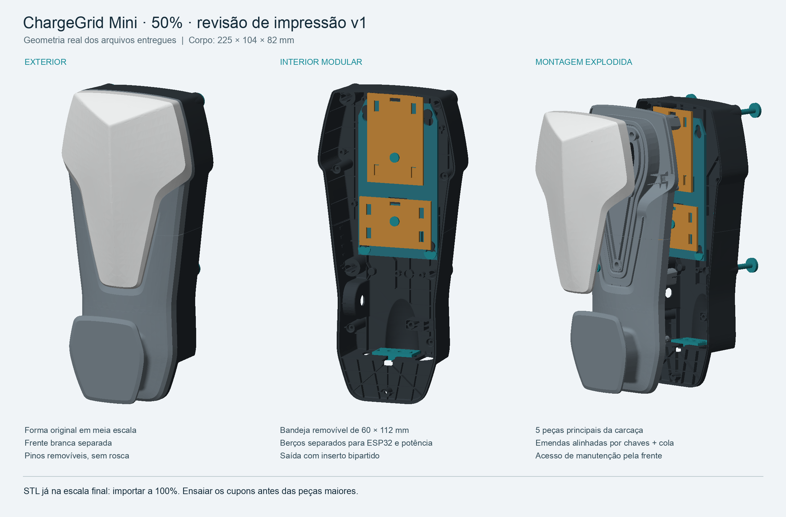

# ChargeGrid Mini — 50% — arquivos de impressão v1

**Corpo de aproximadamente 225 × 104 × 82 mm (altura × largura × profundidade). Os arquivos já estão na escala final: importar em milímetros, a 100%. Não aplicar 50% novamente.**

Revisão finalizada em 9/10/2026, baseada na carcaça do STEP fornecido. Esta é uma revisão mecânica para preparar no fatiador e ensaiar, com superfícies originais trianguladas, interior adaptado e fixações novas. As malhas e a montagem foram verificadas digitalmente. Ainda não houve impressão, teste de força ou montagem com placas reais.

## Abrir os arquivos

- **`stl/`**: peças individuais, orientadas e apoiadas no plano Z=0; nomes correspondem à tabela abaixo.
- **`pranchas/`**: arquivos 3MF com peças distribuídas em uma área de 220 × 220 mm. Contêm geometria e unidades, sem perfil de máquina, suportes gerados ou G-code.
- **`montagem/ChargeGrid-50-MONTAGEM-nao-fatiar.3mf`**: conjunto montado, somente para inspecionar a posição das peças. Não mandar esse arquivo montado para impressão.
- **`montagem/ChargeGrid-50-montado.glb`**: modelo colorido para visualizadores 3D compatíveis.
- **`verificacao/relatorio.json`**: medidas, quantidades, conferência dos STL e testes de interferência.

A impressora ainda não foi definida. A referência adotada foi mesa de 220 × 220 mm, bico de 0,4 mm e PETG. As peças principais, individualmente, ocupam menos de 142 × 105 mm na orientação entregue. Mesmo assim, conferir limites, brim, suportes e primeira camada na máquina que for usada.

## O que imprimir

| Arquivo / prefixo | Quantidade | Função |
|---|---:|---|
| `01-traseira-superior` e `01-traseira-inferior` | 1 de cada | Traseira em duas partes |
| `03-quadro-superior` e `03-quadro-inferior` | 1 de cada | Quadro frontal em duas partes |
| `05-tampa-frontal` | 1 | Tampa branca inteira |
| `06-chave-emenda` | 4 | Alinhamento das emendas: duas atrás e duas na frente |
| `07-pino-quarto-volta` | 4 | Fechamento removível da frente contra a traseira |
| `08-pino-tampa-1` a `08-pino-tampa-5` | 1 de cada | Fixação da tampa branca ao quadro; o nº 5 é o inferior |
| `09-bandeja-removivel` | 1 | Bandeja interna de 60 × 112 mm |
| `10-berco-potencia` | 1 | Berço genérico de 54 × 35 mm |
| `11-berco-esp32` | 1 | Berço genérico de 42 × 64 mm |
| `12-pino-trava-berco` | 2 | Retenção dos dois berços |
| `13-trava-bandeja` | 2 | Impedem a bandeja de subir e se soltar |
| `14-espacador-3mm` e `14-espacador-5mm` | Conforme as placas | Calços móveis; a prancha interna inclui quatro de cada altura |
| `15-prensa-cabo-…-meia` | 2 metades por cabo | Escolher 4, 5 ou 6 mm após medir o cabo |
| `19-inserto-…-a` e `19-inserto-…-b` | 1 par escolhido | Saída bipartida para um cabo, ou dois cabos de aproximadamente 5 mm |
| `16`, `17`, `18`, `20` e `21` | 1 de cada no teste | Cupons dos encaixes desta revisão; não entram na carcaça |

As variantes de inserto e de prensa-cabo são alternativas. Não é necessário imprimir todas. Os insertos possuem folga diametral de 0,5 mm e protegem a passagem; a retenção de tração depende das presilhas e cintas. A prancha de cabos de 5 mm é opcional e só serve se corresponder aos cabos recebidos.

Além das peças impressas, a montagem usa **cola compatível com PETG nas duas emendas estruturais da carcaça e cintas plásticas pequenas para prender placas/cabos**. Não usa parafusos. A frente, bandeja e berços permanecem desmontáveis; a emenda colada de cada metade não é a abertura de manutenção.

## Imprimir primeiro os cupons

Usar `pranchas/00-ensaios.3mf` antes das peças maiores:

1. **Baioneta:** experimentar o pino `07` no bloco `16`. Alinhar as abas com a entrada, inserir e girar 90°. Na posição travada, a tração deve encontrar o batente. O furo do bloco está horizontal na orientação entregue.
2. **Tampa:** sobrepor a placa `18` à bucha `17`; inserir o pino `08-1`. A ponta bipartida deve encaixar e poder ser liberada sem quebrar. Não colar os cupons.
3. **Trilhos:** encaixar `21` em `20` pela extremidade aberta. Deve deslizar sem forçar, sem folga suficiente para escapar para cima.

Fazer pelo menos dez ciclos como triagem. Se houver aperto excessivo, deformação ou quebra, ajustar a compensação dimensional ou a peça pequena e repetir. **Não escalar o conjunto inteiro para corrigir folgas.** O resultado depende da impressora e do material; a verificação digital não mede flexibilidade ou fadiga.

## Referência inicial de fatiamento

- PETG; camada de 0,20 mm nas cascas e 0,16–0,20 mm nas fixações; bico de 0,4 mm.
- Quatro perímetros como referência. Algumas paredes originais reduzidas têm aproximadamente 1,3–1,6 mm e serão preenchidas por menos linhas; revisar o modo de paredes finas/largura variável no fatiador.
- 20–30% de preenchimento nas regiões espessas das cascas; 100% nos pinos, chaves, travas e cupons. As porcentagens são ponto de partida, não um perfil ensaiado.
- Nas quatro metades de corpo, manter a emenda plana na mesa. Adicionar brim se necessário. Revisar apoios nas saliências internas e nos postes.
- Na tampa branca, a face curva externa está voltada para a mesa e requer suporte. As marcas de suporte podem exigir acabamento.
- Os pinos `07` ficam com a cabeça na mesa e precisam de apoio localizado sob as abas. Remover o apoio e conferir o giro no cupom.
- Bandeja, berços, chaves e calços já têm orientação definida. Conferir a prévia de todas as camadas, especialmente rasgos e encaixes. Evitar suportes presos dentro dos furos pequenos.

Não foi gerado G-code, estimativa de tempo ou perfil pronto para uma impressora específica. Reservar espaço adicional no leito quando o fatiador acrescentar brim ou suportes às pranchas.

## Montagem e manutenção

1. Conferir cupons. Unir as duas metades da traseira com duas chaves `06`; repetir no quadro frontal. As emendas têm 0,25 mm de separação de projeto. Usar cola compatível com o material, sem preencher alojamentos de pinos. Deixar curar apoiado e alinhado.
2. Colocar a tampa branca sobre o quadro. Inserir os cinco pinos `08` pelo lado interno do quadro: nº 1/2 no alto, 3/4 no meio e 5 no ponto inferior. Não colar a tampa branca.
3. Passar o cabo inteiro pela abertura de 20 × 14 mm da plataforma inferior e montar o par `19-a/b` ao redor dele. Se o plug comercial exceder essa abertura, deitar o cabo pelo canal frontal de 7 mm com a frente removida; depois montar as duas metades do inserto. Não cortar o cabo. Fixar o inserto e as presilhas usando as ranhuras para cintas. A tração não deve chegar à tomada da placa.
4. Escolher pontos livres no verso das placas para os calços. Prender cada placa ao próprio berço com cintas; não apertar sobre componentes, soldas, botões ou antena. Conferir altura dos pinos e acesso à programação na placa real.
5. Inserir cada berço na bandeja pela abertura superior de seus trilhos e deslizar até o batente. Colocar um pino `12` por berço. Para programar ou trocar uma placa, retirar o berço ou a bandeja se o plug USB não tiver espaço com o conjunto montado.
6. Posicionar a bandeja aproximadamente 5 mm acima da posição final, fazendo as cabeças dos quatro apoios passarem pelos furos largos. Deslizá-la 5 mm para baixo. Inserir as duas travas `13` nas entradas inferiores dos rasgos; a face achatada de cada trava aponta para o apoio acima dela.
7. Aproximar o conjunto frontal da traseira. Inserir os quatro pinos `07` pela traseira, com a ranhura da cabeça na horizontal. Girar 90° para deixá-la vertical e reter a frente. Usar a ranhura com uma moeda, sem forçar. Os pinos têm pequena folga axial de montagem.
8. Para manutenção, destravar os quatro pinos e retirar o conjunto frontal. Remover as travas `13`, subir a bandeja 5 mm e puxá-la para a frente. Não puxar pelos fios. Para soltar a tampa branca, liberar os pinos `08` com o quadro já retirado.

## Espaço eletrônico e limites desta entrega

A redução de 70% para 50% foi solicitada pelo usuário. A carcaça conserva a forma externa principal do arquivo original; os encaixes novos têm dimensões próprias, sem reduzir placas eletrônicas. Detalhes industriais internos foram mantidos onde não atrapalham e removidos nas regiões de montagem; a saída inferior recebeu uma plataforma nova. Os seis microdetalhes soltos da decoração original não foram convertidos em peças frágeis separadas.

Foram conferidas duas **reservas geométricas**, sem representar módulos comprados: ESP32 com 32 × 58 × 8 mm acima do plano de apoio e potência com 48 × 29 × 15 mm acima do apoio. Fios, conectores externos e saliências fora desses volumes precisam ser conferidos na montagem. O berço não usa furação exclusiva de uma placa; pode ser substituído sem reimprimir o corpo.

O modelo exato do ESP32, a placa de potência e o circuito USB ainda não estão definidos/ensaiados. Este pacote não fecha a lista elétrica nem comprova dissipação, funcionamento de recarga ou encaixe de qualquer módulo comercial. O painel e seu firmware permanecem separados.

## Verificação e recuperação

O relatório registra 35 arquivos STL, malhas fechadas, orientação consistente, volume positivo e uma peça conectada em cada arquivo. Os testes digitais incluem separação entre cascas, encaixe dos berços, passagem da bandeja, retirada da frente/tampa e giro/retirada dos pinos. A retenção rígida da baioneta foi verificada por interferência esperada quando se tenta puxá-la travada. Não foi realizada simulação elástica das travas nem ensaio físico.

`referencia/` conserva as três malhas derivadas do STEP e o registro de reparos. `gerar.py` reproduz a revisão usando Python, numpy, trimesh e manifold3d; `parametros.json` registra os parâmetros principais. As dimensões específicas também estão no gerador. `requirements-cad.txt` registra as versões usadas. Para regenerar: executar `gerar.py`, depois `preparar-pranchas.py`. `renderizar.py` refaz as imagens no macOS com o compilador `cc` e a fonte Arial do sistema. Alterações exigem repetir verificações e atualizar os hashes. A renderização vem dessas mesmas malhas, não de uma imagem conceitual gerada por IA.

`SHA256SUMS.json` permite conferir integridade do pacote. Guardar o perfil do fatiador usado nos cupons e alterar primeiro calços, berços, travas ou insertos quando aparecer uma diferença de medida.
