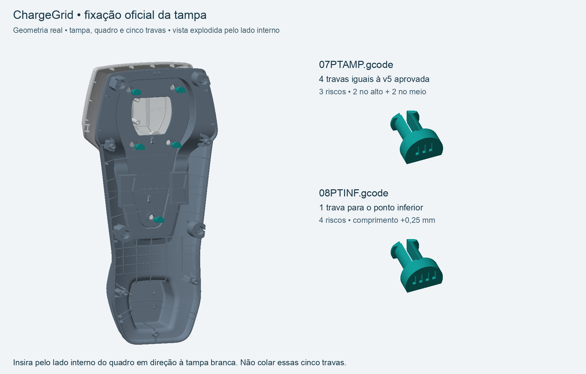

# ChargeGrid — pacote oficial v7 — Ender-3 original / PLA

Revisão de produção de 14/10/2026. O usuário confirmou que os testes passaram e aprovou a trava C da v5. **Esta é a entrega ativa; substitui os pacotes de impressão e testes anteriores. A revisão v7 corrige somente a traseira inferior: use 03TRINF7.gcode no lugar de 03TRINF.gcode. As quatro chaves já impressas e a traseira superior em impressão permanecem iguais.** Carcaça em 50% da escala original, aproximadamente 225 × 104 × 82 mm. Arquivos já na escala final: STL em milímetros, importar a 100%.

## No cartão SD

**Abra CGFINAL e imprima os arquivos de 01 a 11, em ordem, uma impressão por vez. Comece por 01CHAVE.gcode.** Não há novo lote de testes obrigatório. Retire cada impressão e prepare a mesa antes da seguinte; os arquivos não iniciam uns aos outros.

A opção 12CABO.gcode fica em CGFINAL/OPCIONAL. Só é necessária se forem usados dois cabos com diâmetro externo próximo de 5 mm. CGDOC7 contém o ZIP completo para recuperação, este guia, estimativas e a imagem de montagem. Abra esses documentos no computador.

As versões antigas do ChargeGrid são removidas do SD somente depois de conferir a cópia oficial. O histórico e um backup das pastas antigas do cartão ficam no Mac. Outros arquivos do cartão são preservados.

## Ordem de impressão

| Ordem / arquivo | Conteúdo | PLA | Tempo estimado | Suporte |
|---|---|---:|---:|---|
| 01CHAVE.gcode | Quatro chaves das emendas | 2.88 g | 18m 11s | Não |
| 02TRSUP.gcode | Traseira superior | 50.96 g | 5h 56m 16s | Sim |
| 03TRINF7.gcode | Traseira inferior | 57.95 g | 7h 51m 23s | Sim |
| 04QDSUP.gcode | Quadro superior | 38.92 g | 4h 54m 46s | Sim |
| 05QDINF.gcode | Quadro inferior | 67.00 g | 10h 49m 54s | Sim |
| 06TAMPA.gcode | Tampa frontal branca | 44.79 g | 5h 25m 29s | Sim |
| 07PTAMP.gcode | Quatro travas v5 para os pontos superiores e centrais | 0.74 g | 9m 12s | Não |
| 08PTINF.gcode | Uma trava inferior, 0,25 mm mais longa | 0.24 g | 3m 17s | Não |
| 09PINO.gcode | Quatro pinos de quarto de volta com suporte | 4.48 g | 36m 27s | Sim |
| 10BERCO.gcode | Bandeja e dois berços modulares | 28.44 g | 2h 46m 20s | Não |
| 11TRAVA.gcode | Travas internas e espaçadores | 3.10 g | 33m 42s | Não |
| 12CABO.gcode | Opcional: saída para dois cabos de 5 mm | 6.98 g | 1h 3m 53s | Não |

**Arquivos 01–11: 299,50 g de PLA e aproximadamente 39h24. Incluindo 12CABO: 306,48 g e 40h28.** Apenas carcaça e fixações, 01–09: 267,96 g e 36h04. Estimativas incluem brim e suportes; não incluem limpeza, colagem, aquecimento adicional ou eventuais reimpressões.

Cores sugeridas: 02/03 preto; 04/05 cinza; 06 branco; demais à escolha. A troca de cor é feita manualmente entre arquivos. Nenhum G-code solicita troca no meio da impressão.

## Correção das emendas na revisão v7

A conferência específica encontrou interferência de aproximadamente 12,54 mm³ em cada uma das duas chaves traseiras: os apoios inferiores da bandeja tinham sido acrescentados depois do recorte dos alojamentos. Isso não tinha sido verificado antes da entrega v6. Os dois alojamentos do quadro frontal estavam livres.

A v7 reaplica a folga dos alojamentos e libera a entrada das chaves somente na traseira inferior. Retira aproximadamente 48,70 mm³ de material interno no total, preserva o exterior e as hastes dos apoios da bandeja e mantém mais de 94% do volume das cabeças inferiores. A retenção geométrica e a retirada da bandeja também foram verificadas; isso não é um ensaio de resistência.

As quatro chaves existentes continuam sendo utilizadas: 10 × 22 × 3 mm no STL, com última camada em 2,88 mm no G-code aprovado. Os alojamentos têm largura máxima nominal de 10,70 mm, cintura de 6,42 mm e comprimento de 22,55 mm. Foram conferidos quatro encaixes instalados, deslocamentos de 0,15 mm no plano e 49 posições de inserção/retirada por chave, sem interseção. A montagem física completa ainda não foi realizada.

**Não reimprimir 01CHAVE nem 02TRSUP por esta correção. Não usar o antigo 03TRINF.gcode.** A única alteração de G-code é 03TRINF7.gcode; os outros onze continuam idênticos aos da v6.

## Trava aprovada aplicada ao conjunto

- **07PTAMP: quatro travas iguais ao STL da v5 aprovada, com três riscos.** Duas para os pontos superiores e duas para os pontos centrais. Comprimento total 9,55 mm, haste de 3,80 mm e abas de 5,10 mm.
- **08PTINF: uma trava com quatro riscos, exclusiva do ponto inferior.** A posição inferior original tem alojamento 0,25 mm mais profundo; esta variante mede 9,80 mm e mantém a geometria de retenção da v5, deslocada 0,25 mm. O encaixe dessa variante foi conferido no modelo completo; o ensaio físico informado pelo usuário foi da v5 padrão.
- Cada um dos cinco pontos foi conferido no CAD montado: sem interseção com quadro/tampa na posição instalada, cabeça assentada, 0,25 mm de distância nominal ao fundo e retenção ao puxar. As medidas são de projeto, não medições da impressão real.
- **09PINO mantém os quatro pinos de quarto de volta já aprovados, agora com suporte sob a haste/abas.** Remova o suporte antes da montagem.

## Perfil e suportes

Ender-3 original, placa 4.2.2, Bowden e bico de 0,4 mm. PLA 1,75 mm, densidade 1,24 g/cm³. O perfil térmico e de movimentos permanece o que funcionou nos testes: camada de 0,24 mm, três perímetros Arachne, quatro camadas de topo/fundo, bico 210 °C na primeira camada e 205 °C nas demais, mesa a 60 °C. Retração de 5 mm a 35 mm/s, retorno a 25 mm/s e Z-hop de 0,2 mm. Primeira camada a 18 mm/s, parede externa a 25 mm/s, interna a 40 mm/s e preenchimento a 50 mm/s. Limite configurado de vazão de 6 mm³/s.

Casca, bandeja e berços usam 15% de preenchimento. Chaves, pinos, pequenas travas e insertos usam 100%, como na trava v5. Mantidos brim externo de 3 mm, afastamento de 0,1 mm, saia de uma linha e ausência de raft. Ventilador desligado nas duas primeiras camadas, chegando a 100% na quarta.

Suportes gerados em 02, 03, 04, 05, 06 e 09; conferidos também nos trajetos de extrusão. Apoios ajustados ao contorno nas peças indicadas, suporte orgânico no quadro inferior. Distância de contato configurada em 0,20 mm, duas camadas de interface e afastamento XY de 0,35 mm. Não foram colocados suportes nos rasgos das travas v5 deitadas. Os G-codes já incluem os apoios: não é necessário configurar o fatiador para imprimir do SD.

Depois de esfriar, remova brim e suportes em pequenas porções. Confira especialmente alojamentos, trilhos e abas do pino de quarto de volta. A tampa branca tem suporte na face externa curva e pode precisar de acabamento. O quadro inferior é a impressão mais longa, com cerca de 10h50.

Todos os movimentos, incluindo purga, brim e suportes, ficam dentro de 220 × 220 × 250 mm. A linha de purga ocupa X=5–5,4 mm e Y=25–190 mm; deixe os grampos fora dessa região e da área das peças. O início limpa os fatores de velocidade/fluxo, usa M83 e aguarda aquecimento. Não há G29 nem gravação de EEPROM. O final desliga bico, mesa e ventoinha.

## Montagem

1. Após 01–03, remova os suportes das duas traseiras. Una superior e inferior com duas chaves 01, alinhe e cole apenas a emenda estrutural com cola compatível com PLA. Deixe curar alinhado. Não preencha alojamentos.
2. Após 04/05, repita a união no quadro com as outras duas chaves. As chaves registram a posição; a emenda estrutural usa cola. A frente continua removível.
3. Após 06–08, posicione a tampa branca sobre o quadro. Pelo lado interno do quadro, insira as quatro travas de três riscos nos dois pontos altos e dois centrais. Use a trava de quatro riscos no ponto inferior. Não cole essas travas nem a tampa.
4. Após 09, remova completamente os suportes dos quatro pinos. Para fechar o quadro contra a traseira, insira os pinos por trás, abas alinhadas à entrada, e gire 90°. São os pinos grandes de quarto de volta; as travas pequenas da tampa não giram.
5. Após 10/11, coloque os calços sob áreas livres das placas e prenda cada placa ao seu berço com cintas pequenas. Deslize cada berço nos trilhos da bandeja até o batente e use uma trava por berço. Posicione a bandeja cerca de 5 mm acima da posição final, passe as cabeças dos apoios pelas entradas largas, deslize para baixo e coloque as duas travas nos rasgos inferiores.
6. Se usar 12, monte o inserto bipartido e as presilhas ao redor dos dois cabos de 5 mm e retenha com cintas. Não é necessário cortar o cabo. Outras variantes de 4/5/6 mm estão em stl/, para escolher após medir os cabos; não imprimir todas.
7. Para manutenção, libere os quatro pinos de quarto de volta e retire o conjunto frontal. Solte as travas da bandeja para removê-la sem puxar os fios. Para retirar a tampa branca, libere as cinco travas com o quadro já acessível.

Os testes dos encaixes e do perfil foram aprovados pelo usuário; a montagem da carcaça inteira será feita com estas impressões. A bandeja e os berços continuam genéricos e substituíveis. O modelo exato das placas, seus conectores, passagem de fios e dissipação ainda precisam ser conferidos quando a eletrônica for definida. Esta entrega fecha a revisão de impressão mecânica, não a lista elétrica.

## Recuperação

- gcode/: doze impressões prontas, com 12CABO opcional.
- projetos/: doze 3MF com o perfil de cada impressão embutido. Abrir com PrusaSlicer 2.9.6 e manter escala/orientação. Cada projeto contém todo o lote; não importar seu STL junto.
- modelos-fatiados/: STL de cada lote na orientação usada.
- stl/: peças individuais e alternativas de passagem de cabos. Os cinco pinos antigos foram substituídos pelas variantes atuais.
- montagem/: conjunto atualizado, somente para visualização. **Não fatiar o conjunto montado.**
- previas/: vistas dos trajetos reais, incluindo primeira camada e suportes.
- verificacao/: auditoria de G-code, perfis, projetos reabertos, estimativas e verificações das cinco travas no conjunto.
- SHA256SUMS.json: integridade do pacote.

Para refatiar os projetos com CLI, usar `python3 refatiar.py /caminho/PrusaSlicer /pasta/de/saida`. Os 3MF, STL e INI são suficientes para recuperar a impressão. preparar.py registra a correção da traseira inferior a partir da v6; sua execução integral requer a pasta v6 no Mac. geometria-trava.py contém a geometria paramétrica atual da trava.

Todos os doze projetos foram reabertos e refatiados: configuração, quantidade de peças, dimensões e consumo compatíveis conferidos. O fatiador pode reordenar trajetos de objetos separados ao reabrir um 3MF. A auditoria não substitui a qualidade real de aderência, acabamento ou montagem.
