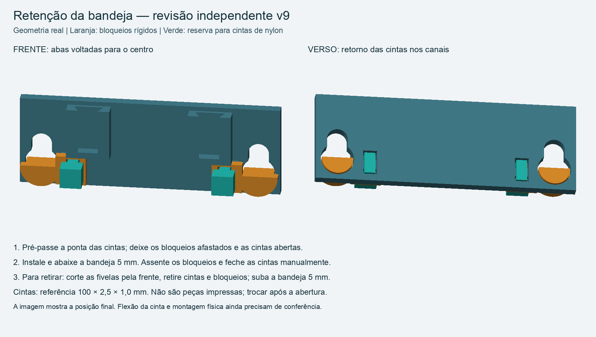
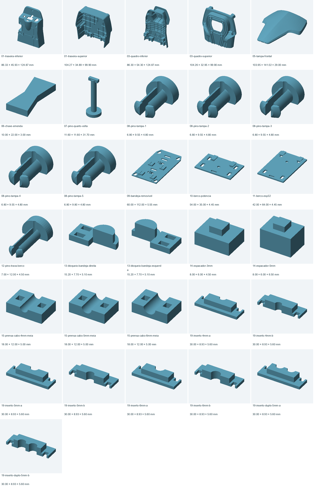

# Revisão integral após parecer independente — ChargeGrid v9

Projeto revisado em 14/10/2026; última conferência completa em 15/10/2026. O usuário pediu uma revisão independente com correções, preservando 01 e 02. Um subagente revisou a v8 sem modificar produção e encontrou um defeito na trava curta D: braços curtos e espessos exigiam flexão excessiva para uma solução confiável em PLA. A estimativa foi um diagnóstico por proporções de viga, não FEA.

**O defeito foi eliminado substituindo essas travas por bloqueios rígidos presos por cintas de nylon. O mesmo revisor conferiu a correção final e os dois novos lotes. Não há defeito digital confirmado em aberto nos casos verificados. A montagem, a resistência e a tolerância físicas continuam pendentes de ensaio.**

## Preservação das impressões existentes

01CHAVE e 02TRSUP preservam byte a byte os oito arquivos protegidos: G-code, STL do lote, INI e 3MF de cada um. Os hashes coincidem com o pacote v6 enviado ao cartão. **Esta revisão não exige reimpressão de 01 ou 02.** Os STL individuais correspondentes também não foram alterados.

## O que mudou nesta rodada

- O bloqueio D deixou de ter rasgo, braços flexíveis ou ressalto de encaixe. Agora há um bloqueio esquerdo e um direito, com abas voltadas para o centro.
- Cada aba recebe uma cinta: a função dela é impedir que o bloqueio saia para a frente. O corpo D continua impedindo a subida que liberaria a bandeja.
- A bandeja recebeu dois pares de furos e canais traseiros de 1,3 mm, evitando que as cintas esbarrem na nervura da traseira durante a instalação. O reforço frontal local chega a 2,8 mm, deixando nominalmente 1,5 mm de material acima do canal. A menor distância no plano ao rasgo existente é aproximadamente 2,05 mm.
- Os canais frontais dos bloqueios têm 0,3 mm de profundidade numa aba de 2 mm. Os furos têm 3,2 × 1,8 mm. A cinta é apertada apenas manualmente, o suficiente para reter.
- Somente os G-codes 10BERCO9 e 11TRAVA9 mudaram em relação à v8. Os pinos compridos dos berços, os oito espaçadores, os berços e toda a carcaça permanecem iguais à v8. O perfil de impressão aprovado continua preservado.

Referência dimensional da cinta: [HellermannTyton T18R 111-01711](https://www.hellermanntyton.com.br/produtos/abracadeiras-com-serrilhado-interno/t18r/111-01711), 100 × 2,5 × 1,0 mm e cabeça de 4,45 × 4,8 × 3,7 mm. São necessárias duas unidades novas por montagem; o envelope CAD reserva cabeça de 5 × 4,8 × 4 mm. Outras marcas só após conferir a fita e a cabeça. As cintas são compradas, não impressas.

## Evidência da conferência

- 31 STL individuais: leitura após exportação, malhas fechadas, orientação consistente, volume positivo e um corpo conectado em cada arquivo.
- 27 instâncias da montagem e 351 pares estáticos sem interseções acima de 0,001 mm³.
- 34 testes de movimento/retenção do conjunto: giro/extração dos pinos grandes, frente, tampa, bandeja carregada, berços e retirada dos bloqueios após cortar as cintas.
- 242 verificações de acessórios, passagem dos cabos e reservas genéricas de eletrônica; incluem amostras de trajetórias e não são ensaios de carga.
- 39 instâncias nos 12 lotes comparadas aos STL individuais por transformação rígida e nuvens de vértices. As 27 instâncias da montagem também correspondem às peças entregues.
- 592 verificações próprias do revisor na correção: cintas contra peças, subida em passos de 0,05 mm, retirada dos bloqueios em passos de 0,1 mm e corredor de acesso frontal. Sem falhas.
- 12 G-codes com limites, temperaturas, retrações, início/final e suportes conferidos. Todos os 12 G-codes foram novamente auditados e os 12 projetos reabertos/refatiados na revisão final de 15/10/2026, sem alterar os arquivos de impressão entregues. O revisor conferiu os dois novos G-codes, os perfis embutidos e a correspondência dos 3MF com os STL de lote.
- Nenhum registro corrente de geração/reabertura contém aviso ou erro do fatiador. As correções anteriores de 03 e dos suportes de 05 permanecem aplicadas.

O parecer separado [REVISAO-INDEPENDENTE.md](REVISAO-INDEPENDENTE.md) registra as evidências, dimensões, limites e hashes conferidos pelo revisor. Os JSON detalhados estão em verificacao/. Os scripts usados pelo revisor foram preservados em fontes-revisao/.

## Substituições para o cartão ainda na versão v6

| Arquivo antigo | Usar |
|---|---|
| 03TRINF.gcode | 03TRINF7.gcode |
| 05QDINF.gcode | 05QDINF8.gcode |
| 10BERCO.gcode | 10BERCO9.gcode |
| 11TRAVA.gcode | 11TRAVA9.gcode |

Se a v8 já tiver sido copiada depois desta conversa, somente 10BERCO8 e 11TRAVA8 precisam ser substituídos pelos lotes 9. Os outros oito arquivos da v6 seguem idênticos. **O SD não foi atualizado nesta rodada.** 01 e 02 já foram impressos; atualize o cartão antes de iniciar 03. Não retire o cartão durante uma impressão.

## Instalação e ensaio físico

Com a bandeja fora, passe a ponta de cada cinta pelo primeiro furo do bloqueio e da bandeja, dê o retorno no canal traseiro e saia pelo segundo furo da bandeja. Deixe o bloqueio afastado e a cinta aberta. Assente a bandeja nos apoios e deslize 5 mm para baixo; então assente os D, passe a ponta pelo segundo furo do bloqueio e feche as cintas manualmente. Cabeça e ponta ficam acessíveis pela frente. Não tente passar a fivela pelos furos.

Para manutenção, corte as fivelas pela frente, retire as cintas e os D, suba a bandeja 5 mm e retire-a. Não há necessidade de flexionar o PLA dos D. Use cintas novas para remontar. O guia inclui imagem e instruções detalhadas, inclusive a ordem de retirada dos berços: ESP32 primeiro, potência depois.

Verifique na impressão que os canais estão limpos, que a cinta se acomoda sem saliência no verso e que as cabeças não encostam em fios/placas. O envelope digital não simula a curvatura da cinta; pode ser necessário pré-curvá-la suavemente. Não force nem tensione com ferramenta.

## Limites que permanecem

A revisão não garante perfeição física. Os pinos compridos dos berços, a variante inferior da tampa, os encaixes completos, as emendas coladas e os bloqueios com cintas ainda precisam de montagem e ensaio reais. Não foram medidos força de retenção, fadiga, empenamento, encolhimento, aderência nem acabamento. As interseções de retenção comprovam obstáculo geométrico, não resistência. As trajetórias são amostradas.

Os módulos eletrônicos finais não foram escolhidos/medidos; berços e reservas continuam genéricos. Não foi certificado encaixe de conectores, passagem final de fios, antena, refrigeração ou funcionamento elétrico. O estado do cartão SD também não foi certificado nesta rodada; a próxima cópia deve ser conferida após remontagem.

## Inventário final

Dimensões dos STL individuais em milímetros, na orientação do arquivo. Alguns lotes aplicam outra orientação; importar a 100%.

| STL | X × Y × Z (mm) |
|---|---|
| 01-traseira-inferior.stl | 86.331 × 45.927 × 124.873 |
| 01-traseira-superior.stl | 104.265 × 34.886 × 99.899 |
| 03-quadro-inferior.stl | 86.301 × 54.305 × 124.866 |
| 03-quadro-superior.stl | 104.264 × 32.950 × 99.899 |
| 05-tampa-frontal.stl | 103.952 × 141.020 × 29.000 |
| 06-chave-emenda.stl | 10.000 × 22.000 × 3.000 |
| 07-pino-quarto-volta.stl | 11.600 × 11.600 × 31.700 |
| 08-pino-tampa-1.stl | 6.800 × 9.550 × 4.800 |
| 08-pino-tampa-2.stl | 6.800 × 9.550 × 4.800 |
| 08-pino-tampa-3.stl | 6.800 × 9.550 × 4.800 |
| 08-pino-tampa-4.stl | 6.800 × 9.550 × 4.800 |
| 08-pino-tampa-5.stl | 6.800 × 9.800 × 4.800 |
| 09-bandeja-removivel.stl | 60.000 × 112.000 × 5.550 |
| 10-berco-potencia.stl | 54.000 × 35.000 × 4.450 |
| 11-berco-esp32.stl | 42.000 × 64.000 × 4.450 |
| 12-pino-trava-berco.stl | 7.000 × 12.000 × 4.500 |
| 13-bloqueio-bandeja-direita.stl | 15.200 × 7.700 × 5.100 |
| 13-bloqueio-bandeja-esquerda.stl | 15.200 × 7.700 × 5.100 |
| 14-espacador-3mm.stl | 8.000 × 6.000 × 4.500 |
| 14-espacador-5mm.stl | 8.000 × 6.000 × 6.500 |
| 15-prensa-cabo-4mm-meia.stl | 18.000 × 12.000 × 5.000 |
| 15-prensa-cabo-5mm-meia.stl | 18.000 × 12.000 × 5.000 |
| 15-prensa-cabo-6mm-meia.stl | 18.000 × 12.000 × 5.000 |
| 19-inserto-4mm-a.stl | 30.000 × 8.925 × 5.600 |
| 19-inserto-4mm-b.stl | 30.000 × 8.925 × 5.600 |
| 19-inserto-5mm-a.stl | 30.000 × 8.925 × 5.600 |
| 19-inserto-5mm-b.stl | 30.000 × 8.925 × 5.600 |
| 19-inserto-6mm-a.stl | 30.000 × 8.925 × 5.600 |
| 19-inserto-6mm-b.stl | 30.000 × 8.925 × 5.600 |
| 19-inserto-duplo-5mm-a.stl | 30.000 × 8.925 × 5.600 |
| 19-inserto-duplo-5mm-b.stl | 30.000 × 8.925 × 5.600 |

A [última revisão completa de 15/10/2026](REVISAO-FINAL-2026-10-15.md) registra a conferência final sem alteração dos arquivos técnicos.
