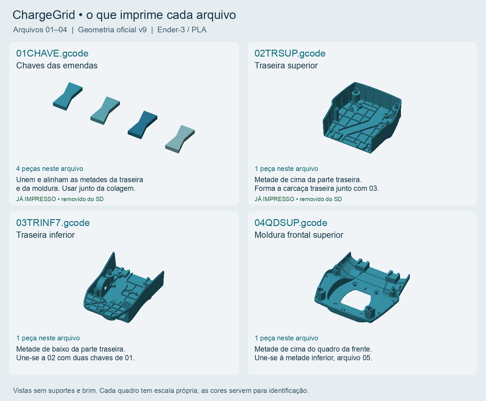
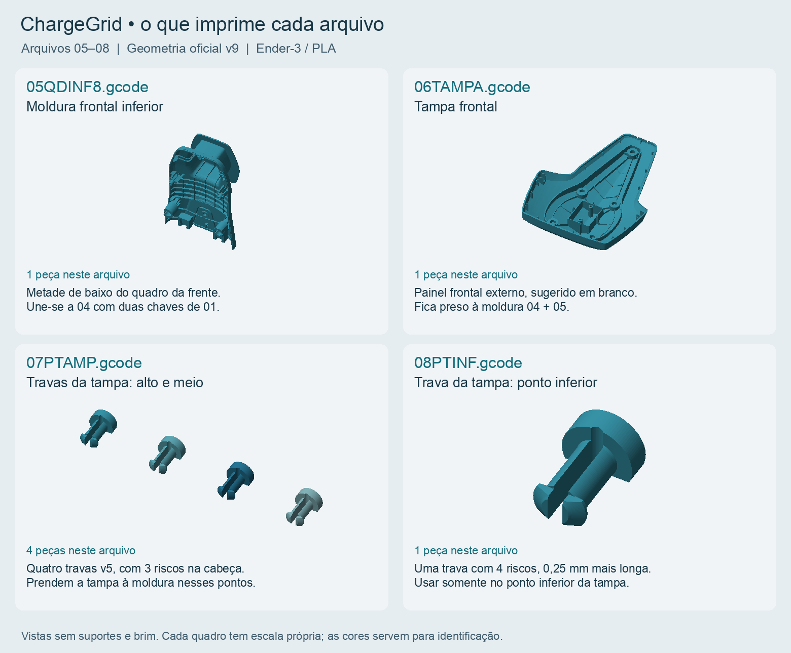
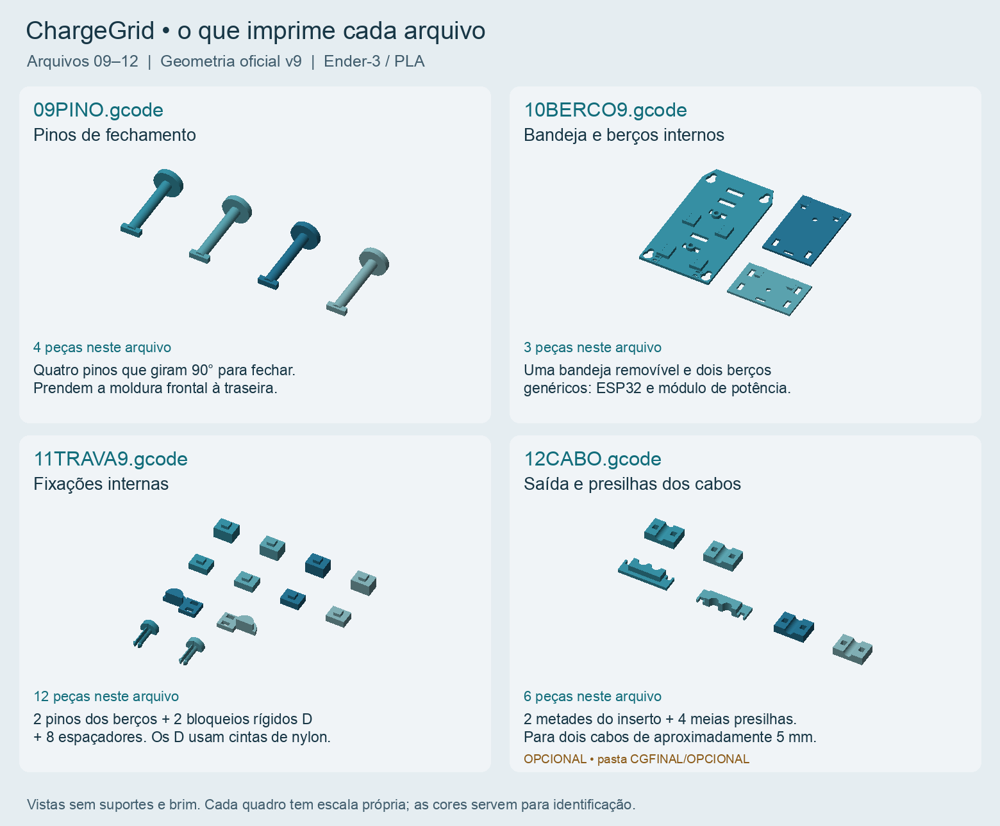

# ChargeGrid — identificação dos arquivos v9

01CHAVE e 02TRSUP já foram impressos e retirados do SD. Os arquivos no cartão começam em 03TRINF7. 12CABO fica em CGFINAL/OPCIONAL. O número no começo determina a ordem; o 7, 8 ou 9 no fim do nome indica a revisão.

As imagens são renderizadas diretamente dos STL de lote oficiais. Cada quadro mostra todas as peças daquele G-code, sem suportes ou brim e em escala própria.

| Arquivo | Peças | Conteúdo / função |
|---|---:|---|
| 01CHAVE.gcode | 4 | **Chaves das emendas.** Unem e alinham as metades da traseira e da moldura. Usar junto da colagem. JÁ IMPRESSO • removido do SD. |
| 02TRSUP.gcode | 1 | **Traseira superior.** Metade de cima da parte traseira. Forma a carcaça traseira junto com 03. JÁ IMPRESSO • removido do SD. |
| 03TRINF7.gcode | 1 | **Traseira inferior.** Metade de baixo da parte traseira. Une-se a 02 com duas chaves de 01. |
| 04QDSUP.gcode | 1 | **Moldura frontal superior.** Metade de cima do quadro da frente. Une-se à metade inferior, arquivo 05. |
| 05QDINF8.gcode | 1 | **Moldura frontal inferior.** Metade de baixo do quadro da frente. Une-se a 04 com duas chaves de 01. |
| 06TAMPA.gcode | 1 | **Tampa frontal.** Painel frontal externo, sugerido em branco. Fica preso à moldura 04 + 05. |
| 07PTAMP.gcode | 4 | **Travas da tampa: alto e meio.** Quatro travas v5, com 3 riscos na cabeça. Prendem a tampa à moldura nesses pontos. |
| 08PTINF.gcode | 1 | **Trava da tampa: ponto inferior.** Uma trava com 4 riscos, 0,25 mm mais longa. Usar somente no ponto inferior da tampa. |
| 09PINO.gcode | 4 | **Pinos de fechamento.** Quatro pinos que giram 90° para fechar. Prendem a moldura frontal à traseira. |
| 10BERCO9.gcode | 3 | **Bandeja e berços internos.** Uma bandeja removível e dois berços genéricos: ESP32 e módulo de potência. |
| 11TRAVA9.gcode | 12 | **Fixações internas.** 2 pinos dos berços + 2 bloqueios rígidos D + 8 espaçadores. Os D usam cintas de nylon. |
| 12CABO.gcode | 6 | **Saída e presilhas dos cabos.** 2 metades do inserto + 4 meias presilhas. Para dois cabos de aproximadamente 5 mm. OPCIONAL • pasta CGFINAL/OPCIONAL. |

Os dois bloqueios D do arquivo 11 precisam de duas cintas de nylon compradas. Os berços do arquivo 10 são genéricos; o encaixe dos módulos eletrônicos reais precisa ser conferido. Nenhum STL, perfil ou G-code foi alterado para gerar este guia.
