# Todos os 12 arquivos de impressão

São 12 G-codes e 39 peças contando as repetições. 01 e 02 já foram impressos e retirados do SD. O arquivo 12 é opcional.

## 01CHAVE.gcode — Chaves das emendas

Unem e alinham as metades da traseira e da moldura. Usar junto da colagem.

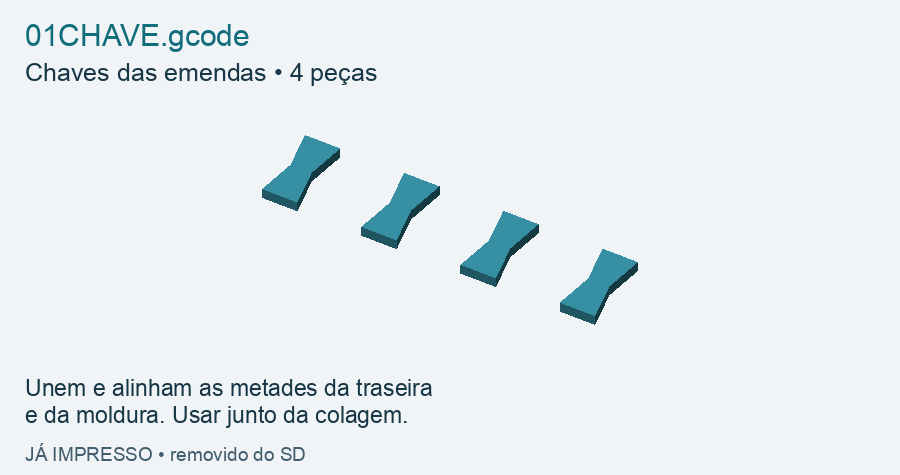

## 02TRSUP.gcode — Traseira superior

Metade de cima da parte traseira. Forma a carcaça traseira junto com 03.

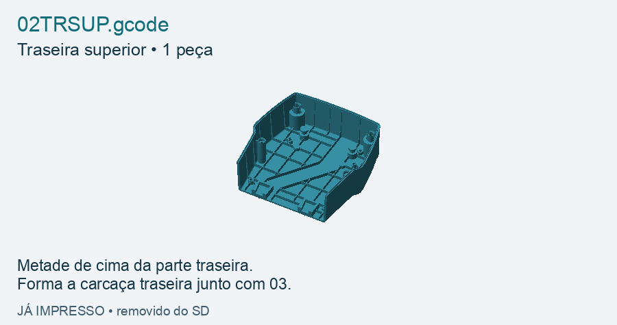

## 03TRINF7.gcode — Traseira inferior

Metade de baixo da parte traseira. Une-se a 02 com duas chaves de 01.

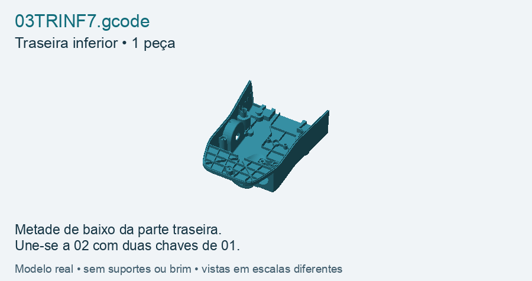

## 04QDSUP.gcode — Moldura frontal superior

Metade de cima do quadro da frente. Une-se à metade inferior, arquivo 05.

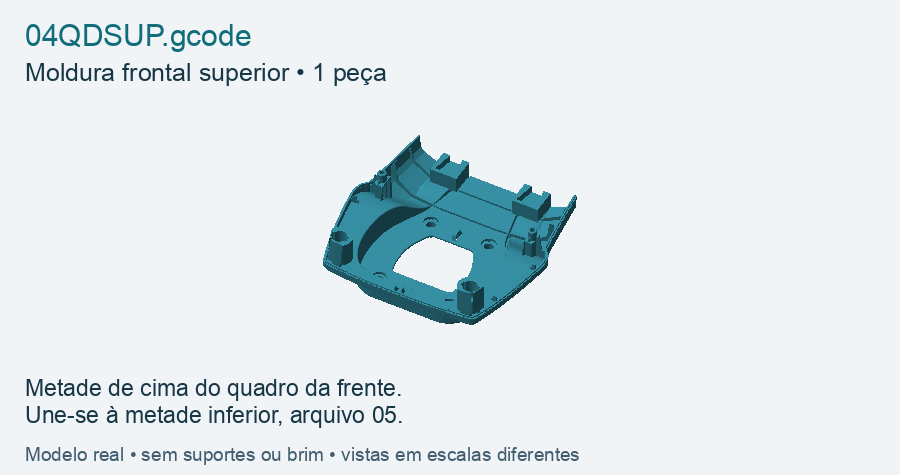

## 05QDINF8.gcode — Moldura frontal inferior

Metade de baixo do quadro da frente. Une-se a 04 com duas chaves de 01.

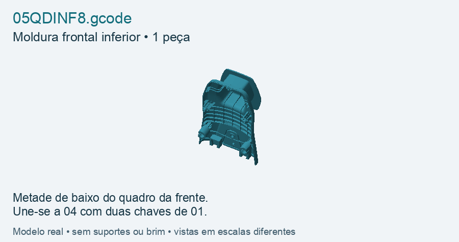

## 06TAMPA.gcode — Tampa frontal

Painel frontal externo, sugerido em branco. Fica preso à moldura 04 + 05.

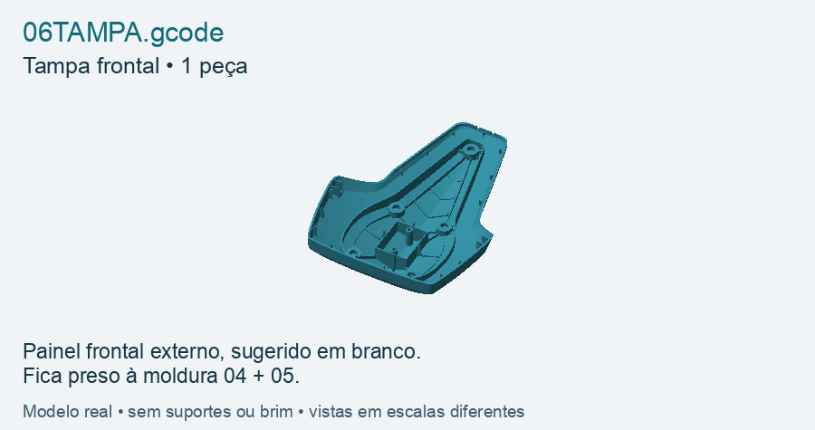

## 07PTAMP.gcode — Travas da tampa: alto e meio

Quatro travas v5, com 3 riscos na cabeça. Prendem a tampa à moldura nesses pontos.

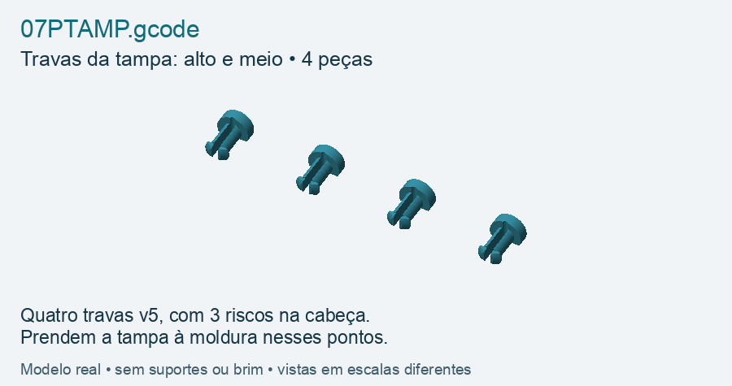

## 08PTINF.gcode — Trava da tampa: ponto inferior

Uma trava com 4 riscos, 0,25 mm mais longa. Usar somente no ponto inferior da tampa.

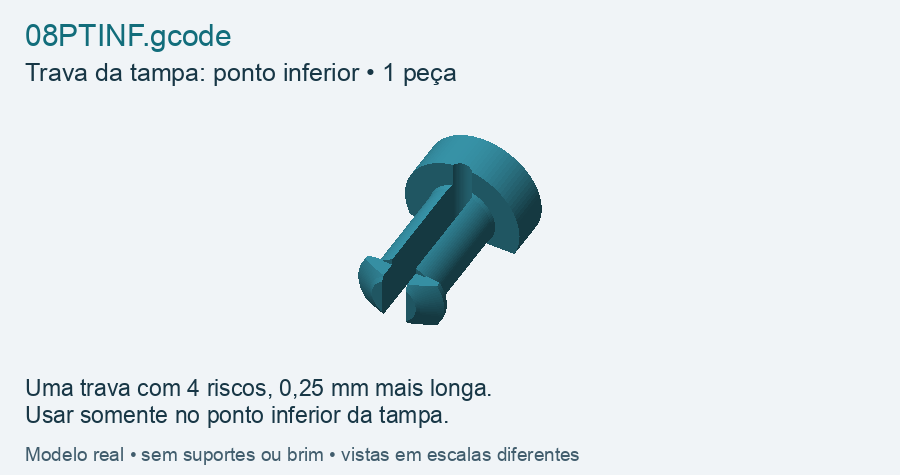

## 09PINO.gcode — Pinos de fechamento

Quatro pinos que giram 90° para fechar. Prendem a moldura frontal à traseira.

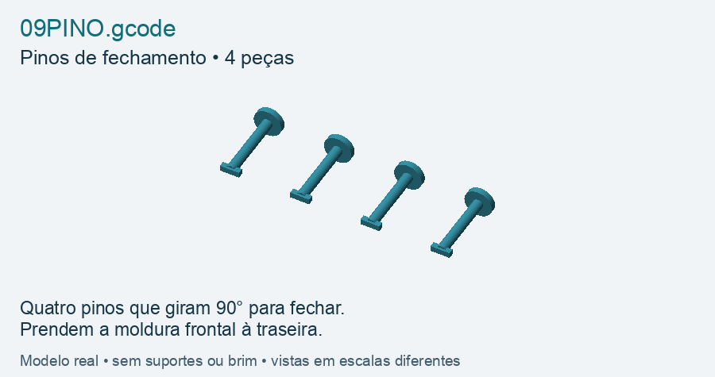

## 10BERCO9.gcode — Bandeja e berços internos

Uma bandeja removível e dois berços genéricos: ESP32 e módulo de potência.

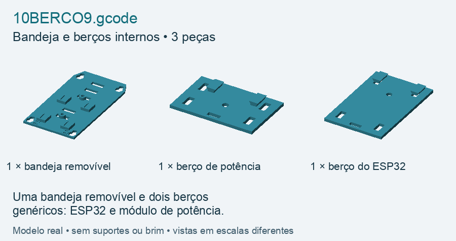

## 11TRAVA9.gcode — Fixações internas

2 pinos dos berços + 2 bloqueios rígidos D + 8 espaçadores. Os D usam cintas de nylon.

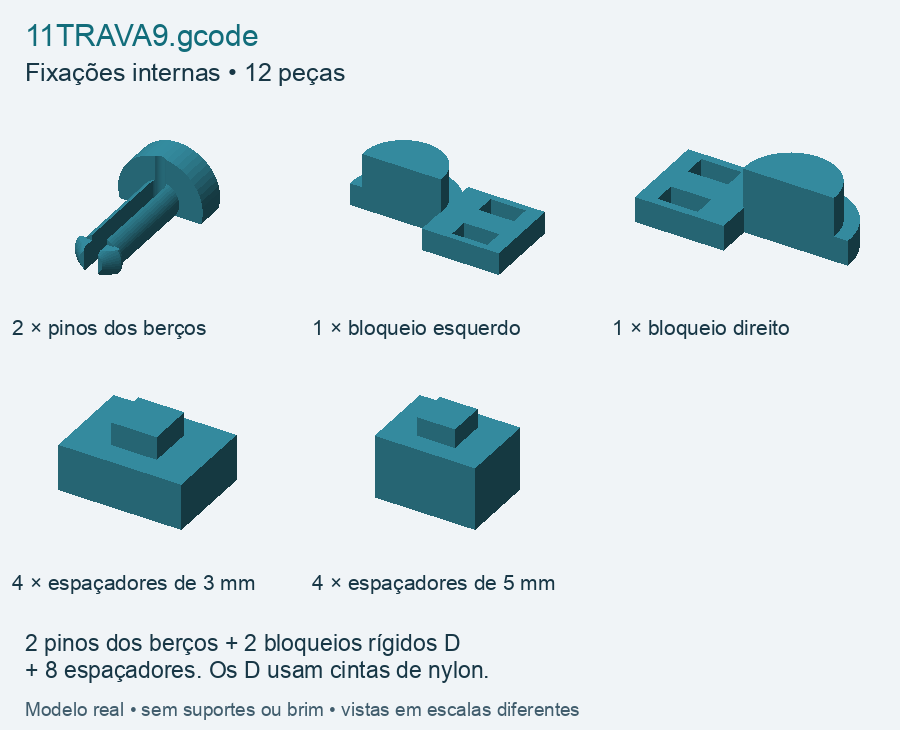

## 12CABO.gcode — Saída e presilhas dos cabos

2 metades do inserto + 4 meias presilhas. Para dois cabos de aproximadamente 5 mm.

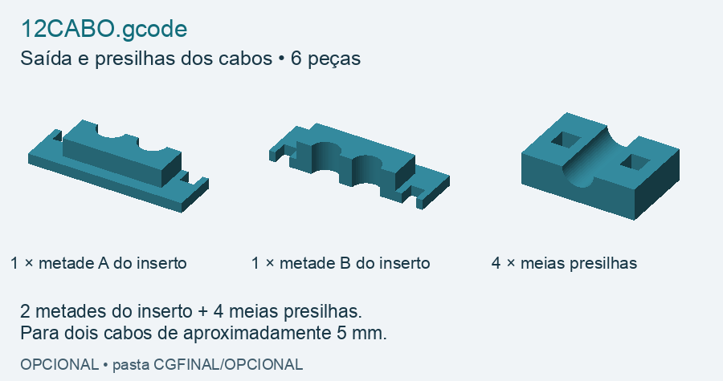
